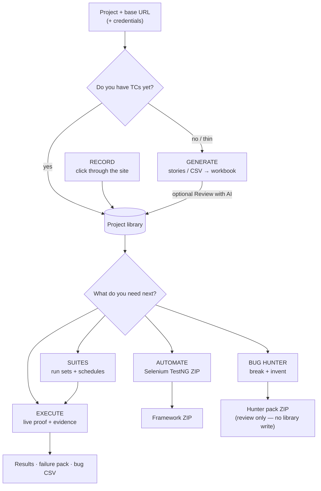
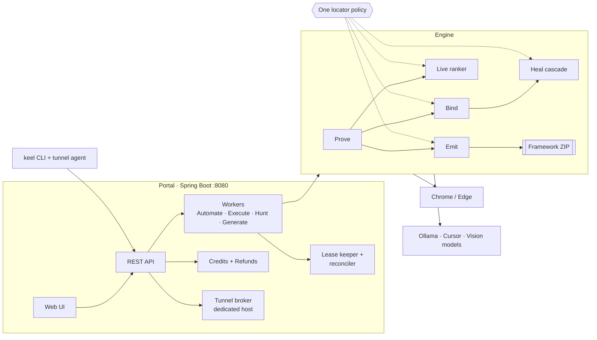
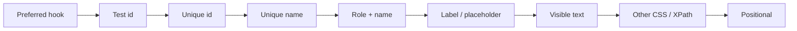
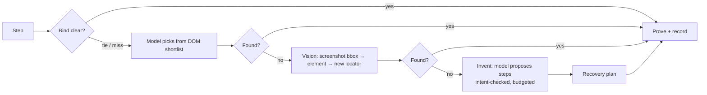
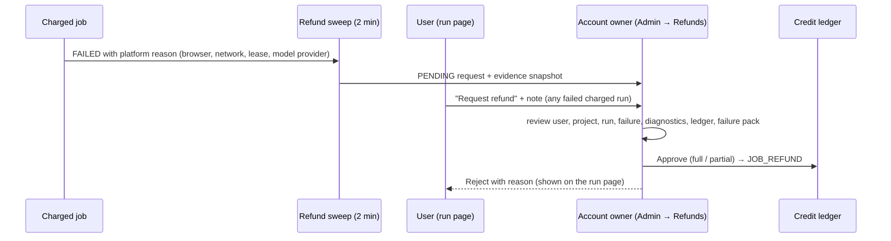
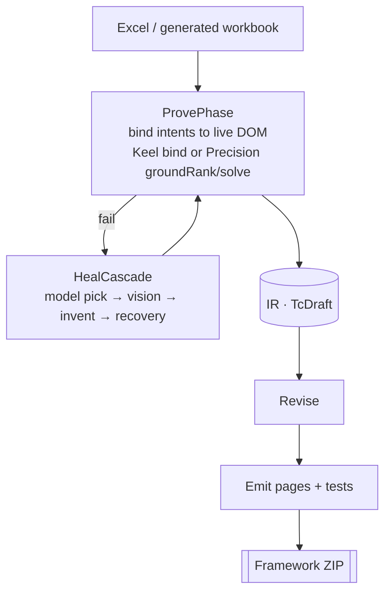

# Keel

**Keel** turns manual test intent into live browser evidence and downloadable Selenium/TestNG automation.

Paste user stories or import structured test cases, prove them against a real site with bind → heal → recovery, then package a customer-ready framework ZIP — or run cases directly on **Execute**.

---

## What you get

| Surface | Purpose |
|---------|---------|
| **Generate** | Stories or external AI JSON/CSV → quality-gated workbook (`latest.xlsx` / CSV) |
| **Record** | Click through the site in Chrome → library case, with locators, then an optional framework build that does not open Chrome again |
| **Automate** | Workbook → live prove + heal → Java Selenium TestNG ZIP |
| **Execute** | Run selected cases against the live site with evidence, without full codegen packaging |
| **Bug Hunter** | Exploratory live hunt: break features + invent edge scenarios → downloadable hunter pack (no auto-merge into the library) |
| **Compare** | Same stories through two local models; save the better set into the project |
| **KeelPath** | Per-case routing: `AUTOMATE` · `EXECUTE` · `VISION_ONLY` · `MANUAL` |

On **Generate**, after a workbook is saved, you can optionally run **Review with AI** (Cursor or Ollama) to spot missing scenarios, ambiguities, and leave-empty / TestData issues before Execute or Automate. The review returns findings and a proposed suite for preview; **Accept** saves the updated workbook, **Discard** leaves the current file unchanged.

On **Execute** and **Automate** you can use the project **Generated library**, select a subset, mix an optional `.xlsx` / `.csv` (upload wins on the same `TC_ID`), and optionally **Review selected TCs with Cursor before run**. Accept uses the proposal for that job only; to keep it, Accept on Generate Review with AI or edit the library on the project page.

Supporting capabilities:

- **Authoring engine** per job: **Keel** (default, deterministic bind + heal) or **Precision** (Cursor `groundRank` + optional `solve`, ~50 API calls/job, Keel fallback)
- Authoring quality gate (leave-empty / vague asserts / field naming)
- Editable TC preview (step × test-data grid before Automate/Execute)
- Project **Generated library** (edit / delete saved cases)
- Heal cascade: DOM bind → Ollama → optional Cursor invent → structured **recovery** plans
- Domains, projects, credentials, design references, and retention under a local store

**Everything Keel can do today:** [`docs/PRODUCT.md`](docs/PRODUCT.md).  
**What shipped in each publish:** [`CHANGELOG.md`](CHANGELOG.md).

---

## Choose your path — entire solution flow

Use this to pick **one primary path** (you can still run others later on the same project library).



### Decision table

| If you want… | Go to | Output |
|--------------|--------|--------|
| Cases from stories or external AI | **Generate** (+ optional **Compare** / Review with AI) | Project library workbook |
| Cases by clicking through the site | **Record** | Library case; optional framework ZIP from the captured locators |
| “Does this written TC pass on the live site?” | **Execute** | Evidence, screenshots, bug export |
| “Give me customer-ready Java automation” | **Automate** | Selenium/TestNG framework ZIP |
| “Break the feature / invent edge cases I didn’t write” | **Bug Hunter** | Hunter pack (bugs + candidate scenarios). Charged per step |
| See what a service costs | **Pricing** | Read-only table. The account owner edits unit prices under **Prices** |
| Route cases by intent | Set **KeelPath** on each TC | Automate vs Execute vs Manual eligibility |

### Recommended happy path (full solution)

1. **Project** — base URL + credential profile.  
2. **Generate** — stories → library (optionally Review with AI → Accept).  
3. **Execute** — small subset → confirm the app behaves.  
4. **Automate** — `AUTOMATE` / blank KeelPath rows → download ZIP.  
5. **Bug Hunter** (optional) — same library TCs → download pack → human reviews bugs/scenarios; import candidates only if you choose.

KeelPath reminder: **Automate** and **Execute** both run every row except `MANUAL` (including `EXECUTE`, `VISION_ONLY`, and blank). Use `MANUAL` to skip both surfaces.

---

## Architecture



### How Keel picks a locator

Every stage (bind, live proof, codegen, vision heal) uses the same ranking, `delivery.locator.LocatorStabilityPolicy`:



- A verified test id or hook is always the primary; text-based locators stay as fallbacks, so the framework survives copy
  changes and Arabic ↔ English switches. Projects can choose **user-facing first** (role + label before test id).
- Generated ids/classes (`ember123`, `css-1x2y3z`, ASP.NET `ctl00$…`, JSF `j_idt12:…`) are never primaries.
- Steps can be written in **Arabic or English** (`اضغط على زر حفظ` binds like `Click the Save button`).
- Generated fields fall back at runtime: `FirstOf.of(primary, fallback1, fallback2)` or `KeelBy.of(...)` for frame/shadow targets.

### When a step does not bind: heal



### Refunds



---

## Stack

- **Java 21** · Spring Boot portal
- **Local Ollama** for generate / authoring (configurable models)
- Optional **Cursor Auto** heal sidecar (`tools/cursor-heal/`)
- Optional vision models (e.g. UI-TARS / Qwen-VL) for grounding and visual asserts
- Filesystem store: `delivery-store/` · H2 file `./delivery-store/portal-db` for portal accounts
- Customer web template: `customer-framework-template/`
- Customer Android template: `customer-mobile-framework-template/` (not a finished device release)

---

## Quick start

### Prerequisites

- JDK 21+
- Maven 3.9+
- Chrome or Edge
- [Ollama](https://ollama.com/) with at least one generate model pulled (see `application.properties`)
- Node.js 18+ if you enable the Cursor heal sidecar

### Run Keel

One step. This loads `api-keys.local.bat`, starts Ollama (`:11434`) and Appium (`:4723`) only if they are down, then opens the portal and the engine:

```bat
start-keel.cmd
```

Portal only (product profile, port 8080). It stops a previous Keel `java.exe` on 8080. It does not stop other programs.

```bat
start-portal.cmd
```

Engine only. It needs the portal and `KEEL_RUNNER_TOKEN` in `api-keys.local.bat`.

```bat
start-engine.cmd
```

Open **http://localhost:8080**. After a CSS or template change, rebuild or restart, then hard-refresh (Ctrl+F5).

Copy `api-keys.local.bat.example` to `api-keys.local.bat` for local keys. Do not commit that file.

Default admin credentials are set in `src/main/resources/application.properties` — **change them before any shared or remote use**.

### Configuration

Primary knobs live in `src/main/resources/application.properties`:

| Key | Role |
|-----|------|
| `delivery.llm-base-url` / `delivery.llm-model` | Ollama endpoint and default model |
| `delivery.generate-model` / `delivery.generate-models` | Generate + Compare model list |
| `delivery.cursor-heal.enabled` | Enable Cursor invent/solve sidecar |
| `delivery.authoring.precision.enabled` | Server gate for Precision jobs (when `false`, UI warns and jobs fall back to Keel) |
| `delivery.authoring.precision.max-calls-per-job` | Cap on Cursor `groundRank` + `solve` calls per Automate/Execute job (default `50`) |
| `delivery.store-root` | Project artifact store (default `./delivery-store`) |
| `delivery.browser.headless` | Headless prove/execute browser |
| `delivery.hunt.dom-mode` | Bug Hunter DOM context: `auto` (page map, slim if thin) · `map` · `slim` |
| `delivery.dry-run` | When `true`, hunts/conversions simulate without a live browser |

API clients should send header: `X-Keel-Requested-With: Keel`.

After Generate UI, prompt, or gate changes: **restart the portal** and hard-refresh the browser.

### CLI

Batch conversion without the UI: `delivery.cli.DeliveryCli` — see `docs/ops/` for local Ollama and ops notes.

```bat
mvn -q exec:java -Dexec.mainClass=delivery.cli.DeliveryCli -Dexec.args="--excel path\to\cases.xlsx --base-url https://example.com --authoring-engine precision"
```

`--authoring-engine` accepts `keel` (default) or `precision`.

---

## Authoring engine (Automate, Execute, All in one)

| Engine | When to use | Bind path |
|--------|-------------|-----------|
| **Keel** | Default; fast; no Cursor API | Deterministic DOM bind → heal cascade (Ollama → Cursor pick/invent → recovery) |
| **Precision** | Complex UIs; needs `CURSOR_API_KEY` | DOM shortlist → one multimodal Cursor `groundRank` → bind on high/medium; one `solve` on low; auto-fallback to Keel on cap or errors |

Configure per project under **Projects → Settings** (applies to Automate, Execute, and All in one). Optional per-project max Cursor calls per job. Stored per job in `automate-runs/{jobId}/request.json` or `execute-runs/{jobId}/request.json`. When any intent falls back, the status page shows a `PRECISION_FALLBACK` banner.

Details: [`docs/ops/end-to-end-flow.md`](docs/ops/end-to-end-flow.md#authoring-engine-automate--execute).

---

## How Automate works



**Recovery** (when page state mismatches the intent, e.g. a field that should be empty is filled): Cursor/invent may return structured JSON (`mode: "recovery"`, `recoverySteps`, `automationNotes`). Keel validates locators on the live page, executes the plan, records evidence (`heal-recovery.json`), retries the same intent, and when recovery clears a field may patch the saved generated workbook (leave-empty Steps + blank TestData) plus coverage / meta notes for Automate.

---

## How Bug Hunter works

```text
Selected library TCs + optional user story + credential profile (tokens only)
        │
        ▼
   brief.md → browser (preferred-hook login or open-site-only)
        │
        ▼
   each cycle: page map (± slim) + screenshot + journal + coverage
        → Ollama/Cursor planner JSON → grounded actions (cap 5, post-click settle)
        → strategies (happy → empty → boundary → abuse → session → invent)
        → oracle drafts + auto-advance when happy blocked on login
        ▼
   dedupe → optional triage recheck → hunter pack ZIP
```

Open **Bug Hunter** in the nav (`/bug-hunter`). Credential profiles use `$TARGET_*` tokens — passwords never appear in planner prompts or pack files. Nothing merges into the generated library until a human imports candidates.

Specs: [`docs/superpowers/specs/2026-09-09-bug-hunter-design.md`](docs/superpowers/specs/2026-09-09-bug-hunter-design.md), [`docs/superpowers/specs/2026-09-10-bug-hunter-quality-design.md`](docs/superpowers/specs/2026-09-10-bug-hunter-quality-design.md), [`docs/superpowers/specs/2026-09-10-bug-hunter-quality-pass2-design.md`](docs/superpowers/specs/2026-09-10-bug-hunter-quality-pass2-design.md).

---

## Repository layout

```text
src/main/java/delivery/     Portal, jobs, authoring, heal, hunt, codegen, Excel
src/main/resources/         application.properties, templates, static UI
keel-portal/                Builds the portal from the sources above
keel-contract/              Runner wire shared with the engine
mobile-contracts/           Android IR and result records
mobile-runner/              Android execute rules (no portal database)
mobile-codegen/             Android screen and test writer
customer-framework-template/  Web Selenium/TestNG core inside every web ZIP
customer-mobile-framework-template/  Android template inside a mobile ZIP
start-keel.cmd              Portal + engine, and Ollama/Appium if they are down
rebuild-portal.cmd          Package the portal fat jar (skip tests; does not start)
tools/cursor-heal/          Cursor Auto heal (+ hunt) sidecar
docs/knowledge/             Current truth (CURRENT.md, review, contracts)
docs/history/               Session history (HISTORY.md, handoffs/YYYY-MM/)
docs/                       Specs (superpowers/), ops guides, reviews
```

## Documentation

| Read | For |
|------|-----|
| [`docs/knowledge/CURRENT.md`](docs/knowledge/CURRENT.md) | What is true now — architecture, flows, locator policy, jobs, refunds, tunnel, config |
| [`docs/ENGINEERING_HANDOFF.md`](docs/ENGINEERING_HANDOFF.md) | Feature → code / spec index |
| [`docs/PRODUCT.md`](docs/PRODUCT.md) | Every user-facing feature |
| [`docs/history/HISTORY.md`](docs/history/HISTORY.md) | Every past session, newest first |
| [`docs/knowledge/REVIEW-2026-11-07.md`](docs/knowledge/REVIEW-2026-11-07.md) | Open risks and recommended next work |
| [`CHANGELOG.md`](CHANGELOG.md) | Dated releases |
| [`docs/README.md`](docs/README.md) | Docs map and rules |

---

## Where things stand (2026-11-07)

- **Locators.** One shared ranking for bind, proof, codegen and vision; test ids first; Arabic steps supported; per-project
  ranking mode. Build and tests for the 2026-11-07 changes still need a local run (see the latest session handoff).
- **Admin.** Refund requests arrive in **Admin → Refunds** with the full failure evidence.
- **Jobs.** Every worker renews its lease; hung or crashed jobs are reclaimed every minute, not only at restart.
- **Tunnel.** Must run on its own host; restarts keep the same token.

Earlier (2026-10-15):

- **Web portal.** Quiet teal theme, dark by default. The Runs table and top bar stay on one row (`keel-layout.css`, commit `0bbee58` on `keel/main`).
- **Start path.** `start-keel.cmd`, `start-portal.cmd`, and `start-engine.cmd`. Package the portal jar with `rebuild-portal.cmd` (does not start). The older `start-portal.bat` launcher is gone.
- **Android.** Native execute and ZIP generation code is in the tree (M0–M4). WebView, vision, and Precision rules have unit tests only (M5). No phone or emulator acceptance run has been done (M6). Do not treat mobile as ready for a device test. Limits: [`docs/ops/mobile-operator-limits.md`](docs/ops/mobile-operator-limits.md).

---

## Security notes

- Do not commit API keys. Use env vars (`CURSOR_API_KEY`, `AGENTROUTER_API_KEY`, `KEEL_RUNNER_TOKEN`, …) or the gitignored file `api-keys.local.bat`.
- Change the portal admin password before exposing the app beyond localhost. Production (`delivery.install.production=true`) refuses the default password, empty allowlist, H2 console, and HTTP public URLs.
- `delivery-store/` and `delivery-work/` hold runtime data and are gitignored.
- Privacy and isolation are **not** launch-complete: screenshot redaction, live-sidecar canaries, and worker-network isolation remain open. See [SUPPORT.md](docs/SUPPORT.md).

## Deployment and support

- Shared **first release**: [docs/ops/shared-staging.md](docs/ops/shared-staging.md). Dedicated remains implemented and out of launch support: [docs/ops/deployment.md](docs/ops/deployment.md), [dedicated-install.md](docs/reviews/2026-09-15/dedicated-install.md).
- Backup/restore drill: [docs/ops/backup-restore.md](docs/ops/backup-restore.md)
- Operator runbooks: [docs/ops/runbooks.md](docs/ops/runbooks.md)
- Document ownership: [docs/reviews/2026-09-15/document-ownership.md](docs/reviews/2026-09-15/document-ownership.md)

Automate and Execute run every library row except `MANUAL` (including `EXECUTE`, `VISION_ONLY`, and blank KeelPath). Precision is configured on **Projects → Settings**, not on the Automate/Execute/Generate start forms. Hunt evidence stays in the hunter pack; it does not merge into the library until a human imports candidates. Login credentials are project-owned profiles, not ZIP contents.

---

## License

Proprietary — all rights reserved unless a license file is added to this repository.
