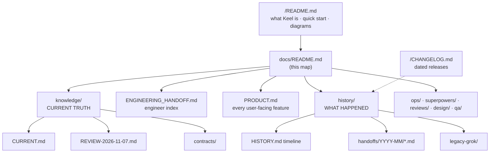

# Keel documentation map

| You want… | Read |
|-----------|------|
| What Keel does and how to run it | [`/README.md`](/README.md) |
| **What is true now** (architecture, flows, locator policy, config, status) | [`knowledge/CURRENT.md`](knowledge/CURRENT.md) |
| Open risks and recommended next work | [`knowledge/REVIEW-2026-11-07.md`](knowledge/REVIEW-2026-11-07.md) |
| Where code and specs live for a given feature | [`ENGINEERING_HANDOFF.md`](ENGINEERING_HANDOFF.md) |
| Every user-facing feature | [`PRODUCT.md`](PRODUCT.md) |
| What happened on a given day / session | [`history/HISTORY.md`](history/HISTORY.md) |
| What shipped, dated | [`/CHANGELOG.md`](/CHANGELOG.md) |
| Resume in Claude Code / Cursor | [`handoff/CLAUDE-RESUME-KEEL-KNOWLEDGE.md`](handoff/CLAUDE-RESUME-KEEL-KNOWLEDGE.md) |
| Specs and implementation plans | [`superpowers/specs/`](superpowers/specs/), [`superpowers/plans/`](superpowers/plans/) |
| Running and operating the portal | [`ops/`](ops/) |

## Rules

1. **Current truth** lives in `knowledge/`. Edit it when behaviour changes.
2. **History** is append-only: a new session adds `history/handoffs/YYYY-MM/YYYY-MM-DD-topic.md` and a row is added to
   `history/HISTORY.md`. Old entries are never rewritten.
3. Every publish adds a dated section to `/CHANGELOG.md`.
4. `handoff/` keeps only the resume entry, the codegen `samples/`, and local `patches/`.
