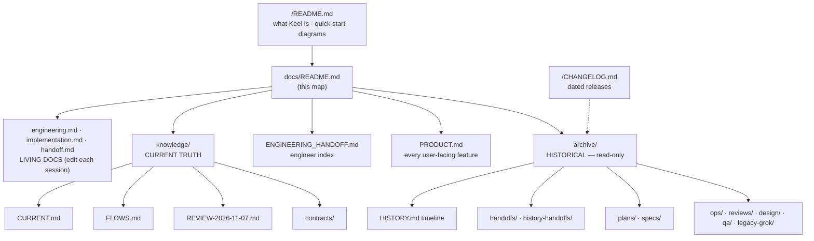

# Keel documentation map

| You want… | Read |
|-----------|------|
| What Keel does and how to run it | [`/README.md`](/README.md) |
| **What is true now** (architecture, flows, locator policy, config, status) | [`knowledge/CURRENT.md`](knowledge/CURRENT.md) |
| How the product flows connect | [`knowledge/FLOWS.md`](knowledge/FLOWS.md) |
| Open risks and recommended next work | [`knowledge/REVIEW-2026-11-07.md`](knowledge/REVIEW-2026-11-07.md) |
| Where code and specs live for a given feature | [`ENGINEERING_HANDOFF.md`](ENGINEERING_HANDOFF.md) |
| Every user-facing feature | [`PRODUCT.md`](PRODUCT.md) |
| What happened on a given day / session | [`archive/HISTORY.md`](archive/HISTORY.md) |
| What shipped, dated | [`/CHANGELOG.md`](/CHANGELOG.md) |
| Resume in Claude Code / Cursor | [`archive/handoffs/CLAUDE-RESUME-KEEL-KNOWLEDGE.md`](archive/handoffs/CLAUDE-RESUME-KEEL-KNOWLEDGE.md) |
| Specs and implementation plans | [`archive/specs/`](archive/specs/), [`archive/plans/`](archive/plans/) |
| Running and operating the portal | [`archive/ops/`](archive/ops/) |

## Rules

1. **Living docs** are `engineering.md` (stable: stack, patterns), `implementation.md` (feature inventory), and `handoff.md` (volatile state — rewrite each session).
2. **Current truth** lives in `knowledge/`. Edit it when behaviour changes.
3. **`archive/` is read-only.** Dated handoffs, plans, specs, ops notes and legacy per-bot status all moved there in the 2026-11-16 cleanup. Nothing new should land in `archive/` — write new session notes as plain prose in `handoff.md`, or as its own top-level file if it is lasting reference.
4. Every publish adds a dated section to `/CHANGELOG.md`.
