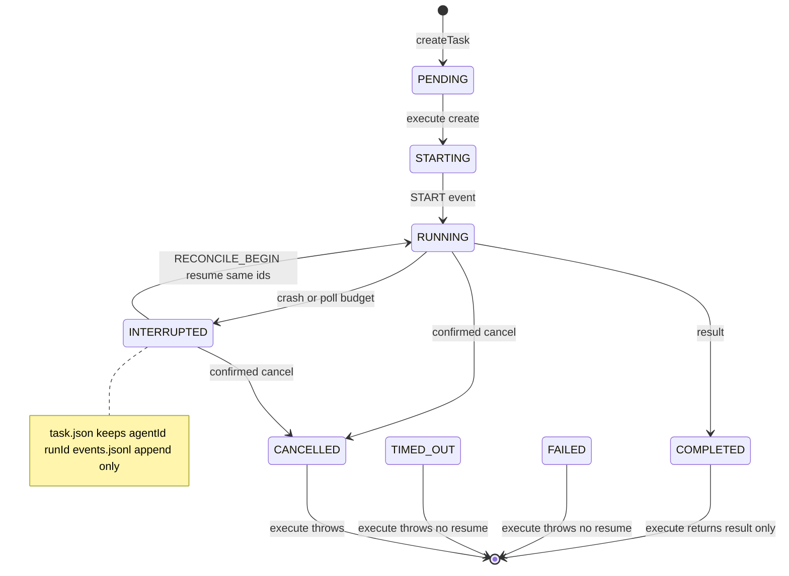
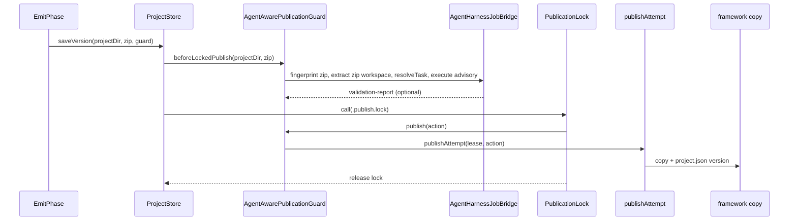

# Agent harness Phase 3 — worker integration plan (final architecture review)

**Status:** **Approved for implementation planning** (architecture); pass 4 locks implementation constraints  
**Revised:** 2026-11-12 (pass 4: integrity vs advisory, report schema, safe zip extract, deferred eviction, report fallback)  
**Builds on:** Phase 2 `89479e6`, prior plan sections (identity, lease, policy A)  
**Evidence:** [`2026-11-12-cursor-sdk-spike-notes.md`](./2026-11-12-cursor-sdk-spike-notes.md)

---

## Inspection index (code actually read)

| Area | Files / methods |
|------|-----------------|
| Task persistence | `AgentRunStore` (`saveTask`, `loadTask`, `appendEvent`, `events.jsonl`); **no list/find API** |
| Coordinator | `AgentHarnessCoordinator.createTask`, `execute`, `cancel`, `markInterrupted`, `enforceConcurrency` |
| Task model | `AgentTask`, `AgentEvent`, `AgentLaunchState`; `AgentTaskStatus` |
| Reconcile | `AgentHarnessReconcile` |
| Lease | `PortalStore.beginWork` → `LeaseKeeper`; `ConversionWorker.runWithProgressMirror` |
| Emit artifact | `EmitPhase.emit` — `packager.zip(projectDir, zip)` (`L180–182`), then `saveVersion` (`L212`) |
| Packaging rules | `FrameworkPackager.zip` — filtered tree (`shouldInclude` / `shouldSkipDirectory`, `L160–187`, `L189–251`) |
| Workspace copy | `AgentWorkspacePreparer.ensureIsolatedCopy` — **full** directory tree (`L47–67`), no zip filter |
| Publish payload | `ProjectStore.saveVersion` — `copyRecursive(frameworkDir)` + `Files.copy(zipFile)` + `scrubLocalSecretProperties` on copy only (`L67–78`, `L185–196`) |
| Publish lock | `ProjectStore.saveVersion` (`L64–121`), `PublicationLock.call` (`PublicationLock.java:34–66`) |
| Publish fence | `PublicationGuard`, `ConversionWorker` guard (`L107–110`), `PortalStore.publishAttempt` (`L805–811`), `DurableJobClaim.mayPublish` |
| Project paths | `ProjectStore.projectRoot`, lock file `root.resolve(".publish.lock")` |
| Flags | `AgentHarnessProperties` (`enabled`, `frameworkValidationEnabled`, defaults **false**) |
| Zip safety patterns | `MobileInputZipValidator.rejectUnsafeName` + bounded read (`mobile/transport/MobileInputZipValidator.java:72–108`); test pattern `dest.normalize().startsWith(destRoot)` (`SharedInstallDrillTest.java:155–156`) |

---

## 1. Task identity (stage + immutable input)

### 1.1 Why add input identity

`parentJobId + stageKey` alone is insufficient: the same portal job can reach the pre-publish hook more than once (worker retry, reclaim, or rare re-emit) with **different** emitted trees. Reusing a task tied only to job+stage could validate the wrong artifact or skip validation incorrectly.

### 1.2 Recommended input fingerprint (no new hashing subsystem)

Use the **emit package ZIP** already built immediately before publication:

| Source | Detail |
|--------|--------|
| `EmitPhase.emit` | `Path zip = workDir.resolve("package.zip")` after `packager.zip(projectDir, zip)` (`EmitPhase.java:180–182`) |
| Algorithm | Same as `ProjectStore.sha256(Path file)` — SHA-256 hex of **zip file bytes** (`ProjectStore.java:249–256`) |
| **Not** used for Phase 3 identity | `tc-hashes.json` (per-case, `EmitPhase.java:185–188`) — useful context only; not a full-framework fingerprint |
| **Not** used pre-publish | `project.json` `version` / artifact row — assigned **inside** `saveVersion` after copy (`ProjectStore.java:74–100`) |

**`inputFingerprint`** = full SHA-256 hex of `package.zip` at validation time. Persist on the harness task and in the stage registry. This matches the artifact SHA written in `project.json` (`ProjectStore.saveVersion` hashes the copied `v{N}.zip`, which is a byte copy of `package.zip`, `L76–78`).

### 1.2a Artifact consistency (zip fingerprint vs validation workspace)

**Finding — not guaranteed today if validation copies `projectDir`:**

| Artifact | What it contains |
|----------|------------------|
| `package.zip` | **Filtered** subtree per `FrameworkPackager.shouldInclude` / `shouldSkipDirectory` (`FrameworkPackager.java:160–251`). Excludes e.g. `target/`, `delivery-target.local.properties`, several sample `.java` files (`L238–251`). |
| Isolated workspace (Phase 2) | `AgentWorkspacePreparer` copies **every** file under `projectDir` with no packager filter (`AgentWorkspacePreparer.java:47–67`). |
| Published `framework/` | **Unfiltered** `copyRecursive(frameworkDir, framework)` then `scrubLocalSecretProperties` on the **destination** only (`ProjectStore.java:72–73`, `L185–196`). |
| Published `versions/vN.zip` | Exact bytes of `package.zip` (`ProjectStore.java:77`). |

So: **fingerprinting `package.zip` does not describe the full published directory tree**, and **a `projectDir` copy is not identical to zip contents** (agent may see paths/files that are not in the client package zip).

**Emit-time immutability (single convert attempt):** After `packager.zip(projectDir, zip)` (`EmitPhase.java:182`), `EmitPhase` only writes under `stagedState` until `saveVersion` (`L184–210`). No code in that window mutates `projectDir` or rewrites `package.zip` on the worker thread. Evidence only for this sequential path — not a global “directory is immutable” invariant.

**Smallest safe correction (plan):**

1. **Identity** — keep `inputFingerprint` = SHA-256(`package.zip`) (aligns with `project.json` artifact row).
2. **Validation workspace** — materialize isolated workspace by **extracting `package.zip`** into `taskDir/workspace/` (bridge step before `coordinator.execute`), not `ensureIsolatedCopy(projectDir)`. Reuse `FrameworkPackager` exclusion rules indirectly by trusting zip entries only.
3. **Report fields** — `validationScope=PACKAGED_ZIP`, `workspaceSource=ZIP_EXTRACT`, `inputFingerprint` (§4.7).

Do **not** fingerprint raw `projectDir` for Phase 3 identity unless product explicitly wants directory-level validation.

### 1.2b Safe extraction of `package.zip` into task workspace

Keel already encodes zip entry safety in **`MobileInputZipValidator`** (absolute paths, `..`, bounded size/count) and extraction confinement in tests (`dest.startsWith(destRoot)` after `normalize()`). There is **no** shared desktop-framework unzip helper today; Phase 3 should add a **small bridge-local** extractor (or package-private util beside the bridge) that applies the same rules—not a new subsystem.

**Target directory:** `taskDir/workspace/` (same as `AgentWorkspacePaths.isolatedWorkspace`).

| Threat | Rule |
|--------|------|
| Absolute paths (`/`, `//`) | Reject entry name (`MobileInputZipValidator.rejectUnsafeName`, `L80–82`) |
| `../` traversal | Reject any `..` path segment (`L83–87`) |
| Escape target root | Resolve `destRoot.resolve(entry).normalize()`; require `dest.startsWith(destRoot)` (`SharedInstallDrillTest` pattern) |
| Symlinks in archive | Do not create symlinks; write regular files/dirs only (`LinkOption.NOFOLLOW_LINKS` on read if needed) |
| Entry count | Cap (e.g. same order of magnitude as mobile validator default; tunable property) |
| Expanded size | Sum uncompressed bytes per entry with bounded drain (`drainBounded`, `L97–108`) |
| Corrupt zip | `IOException` → **integrity** path (§5.7), not advisory warning |

**Retry / cleanup:** If extract fails partway, **delete** `taskDir/workspace/` recursively and recreate on retry (mirror `AgentWorkspacePreparer` delete-before-copy, `AgentWorkspacePreparer.java:34–37`). If a prior successful extract exists for the **same** `inputFingerprint`, may reuse non-empty workspace only when fingerprint unchanged (optional optimization).

**Symlinks in source zip:** `FrameworkPackager.zip` writes normal files only (`Files.copy` into `ZipOutputStream`, `FrameworkPackager.java:175–183`); extractor still must defend against malformed zips.

### 1.3 Composite lookup key

```text
harnessKey = parentJobId + "\0" + stageKey + "\0" + inputFingerprint
```

| Field | Value |
|-------|--------|
| `parentJobId` | `JobRecord.jobId` |
| `stageKey` | `CONVERT_PRE_PUBLISH` (Phase 3 single stage) |
| `inputFingerprint` | SHA-256(`package.zip`) |

**`taskId` (deterministic):** `fp_` + first **24** hex chars of SHA-256(`harnessKey`) (matches `AgentRunStore` SAFE_ID).

**Registry:** `agent-runs/{parentJobId}/stage-index.json` (see §1.4 for schema).

### 1.4 Stage index, conflicts, and discovery

**Schema (minimal):**

```json
{
  "CONVERT_PRE_PUBLISH": {
    "active": { "inputFingerprint": "<hex-A>", "taskId": "fp_..." },
    "deferred": null
  }
}
```

- **`active`** — the in-flight or most recently started validation for this stage; **only** field used for “find running task for reconcile.”
- **`deferred`** — optional `{ inputFingerprint, taskId }` when a **non-active** fingerprint arrived while `active` is non-terminal; **does not** replace `active`.
- **One deferred slot (Phase 3):** **latest-wins** — if B is deferred and C arrives before A terminal, set `deferred = {C, taskId(C)}` and record B as skipped (audit below). A unchanged.

**Lock:** `PublicationLock.call(agent-runs/{parentJobId}/.stage-index.lock, …)` (same primitive as project publish lock, separate file).

**Operations:**

| Event | Index change |
|-------|----------------|
| Create task for fingerprint F | Under lock: if `active` missing or `active` terminal → set `active = {F, taskId}`. |
| F matches `active.inputFingerprint` | Reuse `active.taskId` (resolve / execute / cache). |
| F ≠ `active.inputFingerprint` and `active` **non-terminal** | **Do not overwrite `active`.** Set `deferred = {F, taskId(F)}` (evict prior `deferred` if any). Append audit event for skipped fingerprint(s). **Publish current emit anyway** (advisory skip for F). |
| F matches `deferred.inputFingerprint` (A still active) | Still **no** Cursor run; publish; deferred unchanged. |
| F ≠ `active` and `active` **terminal** | Set `active = {F, taskId(F)}`; clear `deferred` if F matches deferred, else leave or clear per promotion rules below. |
| Crash mid-update | On read: if `active.taskId` dir missing or corrupt, fall back to scan `task.json` by `inputFingerprint`; rebuild `active` from disk. |

**Audit for skipped / evicted fingerprints (not validated):**

- Append `events.jsonl` on the **skipped** fingerprint’s task dir (create dir + `task.json` stub if needed): `VALIDATION_SKIPPED`, reason `ACTIVE_CONFLICT` or `DEFERRED_EVICTED`.
- Report field when publish proceeds without validation: `validationStatus=SKIPPED`, `validationScope=PACKAGED_ZIP`, **`validated=false`** — must **not** use `COMPLETED` or advisory finding severities.
- Deterministic `taskId` for B/C still computed and persisted so operators can find history; absence of `COMPLETED` + `validated=true` means **not validated**.

**Promotion when A becomes terminal:**

1. Under lock, if `deferred` present → move `deferred` → `active` (do not auto-start Cursor during publish; next convert with that fingerprint runs validation).
2. If incoming fingerprint F equals new `active`, run normal resolve/execute path.
3. If `deferred` was evicted (B lost to C), B remains on disk with skip events only—never promoted unless a later convert presents B’s fingerprint again.

**JVM restart:** `resolveTask(parentJobId, stageKey, inputFingerprint)` reads **`active`** first when fingerprints match; else scan task dirs — never mint random UUID.

### 1.5 Behavior matrix

| Case | Action |
|------|--------|
| Same job + same stage + **same** `inputFingerprint` | **`resolveTask`** → `active.taskId`. If `COMPLETED` + `result.json`: cached report. If `RUNNING`/`INTERRUPTED`+ids: `execute` reconcile **only while convert hook is running** (§2.6). |
| Same job + same stage + **different** fingerprint, `active` terminal | New task; update `active` under lock. |
| Different fingerprint, `active` non-terminal | **Conflict** — §1.4; no second Cursor run; **do not** overwrite `active`. |
| JVM restart | Disk: `stage-index.json` + `task.json` + `inputFingerprint` field. |

### 1.6 Duplicate prevention

1. Portal lease — one worker per job attempt (`DurableJobClaim.tryClaim`).
2. Harness — one **active** validation per `(parentJobId, inputFingerprint)`; `enforceConcurrency` unchanged for parent job.
3. Registry updates — serialize with `agent-runs/{parentJobId}/.stage-index.lock` (**not** project `.publish.lock`).

### 1.7 Complexity budget

- **One** fingerprint field, **one** stage key, **one** index file per parent job.
- No versioning of `tc-hashes` into task id; no directory-tree walks for identity.

---

## 2. `INTERRUPTED` recovery and event history

### 2.1 What exists today

- **Audit:** `AgentRunStore.appendEvent` → append-only `events.jsonl` (`AgentRunStore.java:63–68`).
- **Events used:** `TASK_CREATED`, `START`, `RECOVER`, `TERMINAL`, `CANCEL` (`AgentHarnessCoordinator.java`).
- **`markInterrupted`:** sets `INTERRUPTED` via `withStatus` — **preserves** `agentId` / `agentRunId` on `AgentTask` (`AgentHarnessCoordinator.java:265–268`).
- **`execute` block:** `INTERRUPTED` throws at `L108–109` (no resume); `COMPLETED` returns cached `result.json` (`L101–103`).
- **Recover path:** only when `RUNNING` + ids (`L141–152`); appends `RECOVER` event, does not clear history.

### 2.2 Target transitions (policy A, auditable)



**`INTERRUPTED` → `RUNNING` is not a new SDK agent:** same `taskId`, same `agentId`/`runId`, reconcile sidecar only (`RECOVER` / new `RECONCILE_BEGIN` event).

### 2.3 Idempotency and terminal guards

| Rule | Implementation |
|------|----------------|
| Preserve ids on `INTERRUPTED` | Already via `withStatus`; verify `markTimedOutOrInterrupted` does not blank ids |
| **Do not reset** `events.jsonl` | Append only; never truncate on resume |
| **Do not increment** `AgentTask.attempt` on reconcile | `attempt` bumps only for **new** logical harness attempts (new `inputFingerprint` or explicit product retry) |
| **`execute` idempotency** | `COMPLETED` → load `result.json`; `FAILED`/`TIMED_OUT`/`CANCELLED` → throw (no re-entry) |
| Repeated reconcile | Each `execute` may append `RECONCILE_BEGIN`; terminal `COMPLETED` written once with existing `result.json` check |
| Launch state | `launch-state.json`: `INTERRUPTED` / `RECONCILING` / `RUNNING`; **same** `idempotencyKey` suffix `a{attempt}` on reconcile |

### 2.4 Minimum persistence / event changes

| Change | Scope |
|--------|--------|
| `execute`: treat `INTERRUPTED` + ids like `RUNNING` + ids | `AgentHarnessCoordinator` |
| On resume: `appendEvent(RECONCILE_BEGIN, …)` not `TASK_CREATED` | Coordinator |
| On poll budget: sidecar → `INTERRUPTED`, **no** default `cancelRun` | `agent.mjs` |
| Optional `AgentTask.inputFingerprint` + schemaVersion bump | `AgentTask` record |
| **No** new enum required if `launch-state` carries `RECONCILING` | Prefer launch-state over `RECONCILE_PENDING` |

### 2.5 Scenario table (unchanged intent, audit emphasis)

| Scenario | Disk after | Next action | Audit |
|----------|------------|-------------|-------|
| Worker crash, Cursor running | `RUNNING`, ids, partial events | Reconcile | `RECONCILE_BEGIN` |
| Poll budget exhausted | `INTERRUPTED`, ids kept | Reconcile later | `TERMINAL` + `RECONCILE_BEGIN` |
| Cursor finishes while `INTERRUPTED` | Reconcile sees finished | `COMPLETED`, `result.json` | `TERMINAL COMPLETED` |
| Job cancel | `CANCELLED` | No execute | `CANCEL` |
| Completed task | `COMPLETED`, `result.json` | `execute` returns cache | No new events |

### 2.6 Reconciliation after the convert job finishes

**Code fact:** Portal has **no** background worker that calls `AgentHarnessCoordinator.execute` for in-flight harness tasks. `JobLeaseReconciler` only runs `PortalStore.reconcileExpiredLeases()` (`JobLeaseReconciler.java:32`, `PortalStore.java:814–828`). Harness reconcile is triggered **only** by an explicit `execute()` invocation (`AgentHarnessCoordinator.execute`).

**Therefore:**

- If validation is still `RUNNING` / `INTERRUPTED` when `beforeLockedPublish` returns, publication **still proceeds** (advisory, §4.3).
- **Completing** an interrupted harness task after `ConversionWorker.runOne` has finished requires a **subsequent invocation**: e.g. a later convert on the same artifact (cache/reconcile), a dedicated admin/ops command, or a **future** scheduled reconciler (**out of scope Phase 3**).
- Correct the prior wording “reconcile may finish asynchronously for reporting only” — Phase 3 has **no automatic async reconciler**; job message may say “validation incomplete” until something calls `execute` again.

---

## 3. Job lease and runtime budget

*(Unchanged from prior revision — see §3 in pass 1; still valid.)*

- Lease renewal continues during blocked `runOne` via `LeaseKeeper` + `ConversionWorker` progress heartbeat.
- Map **remaining** lease/max-runtime to `AgentPolicy`, not static `maxRuntimeMinutes`.
- Specify **`ConversionWorkerHarnessLeaseIT`** (long fake sidecar).

---

## 4. Advisory validation and `AgentAwarePublicationGuard`

### 4.1 Phase 3 product rule

**Advisory only:** Cursor **validation outcomes** (findings, agent failure, timeout, incomplete) **must not** block publication. Master flag off must match **today** exactly.

**Not advisory — artifact integrity (§5.7):** ZIP fingerprint mismatch, corrupt zip, or unsafe/forbidden extraction **are not** validation warnings. They use separate statuses and **may** abort publication inside the locked transaction. Implementations must **not** map integrity failures to `validationStatus=SKIPPED` or job-message “advisory warnings.”

### 4.2 Flag gating (exact)

| Condition | Behavior |
|-----------|----------|
| `delivery.agent-harness.enabled=false` | Bridge never called; guard is **byte-for-byte equivalent** to current `ConversionWorker` anonymous `PublicationGuard` (`L107–110`) → `publishAttempt` only. |
| `enabled=true`, `frameworkValidationEnabled=false` | No validation; same as today. |
| `enabled=true`, `frameworkValidationEnabled=true`, `cursorEnabled=false` | Skip Cursor validation; optional local stub report “cursor disabled”; **publish**. |
| All validation flags on | Run advisory harness per §4.3 |

Coordinator `execute` throws if `!properties.isEnabled()` — bridge must check flags **before** calling coordinator.

### 4.3 Outcome matrix

**Advisory paths (publication proceeds):**

| Condition | Report (`validationStatus`) | Publication |
|-----------|----------------------------|-------------|
| Cursor unavailable | `UNAVAILABLE` | **Publish** |
| Agent `FAILED` | `FAILED` | **Publish** |
| `TIMED_OUT` / `INTERRUPTED` at hook | `INCOMPLETE` | **Publish** (§2.6) |
| Critical findings in report | `COMPLETED` + findings | **Publish** — severities **never** gate |
| Clean validation | `COMPLETED`, `validated=true` | **Publish** |
| Active conflict / deferred skip (§1.4) | `SKIPPED`, `validated=false` | **Publish** |
| Extract/harness fail-open (§4.6) | `SKIPPED` + reason | **Publish** |

**Integrity paths (§5.7 — not advisory):**

| Condition | Publication |
|-----------|-------------|
| Locked `sha256(zip) != inputFingerprint` | **Abort** (`IllegalStateException` in publish transaction) |
| Corrupt zip / zip-slip / over limit at extract | **Abort before publish** if detected pre-lock; if only detected at locked re-check, **abort** same as mismatch |

**Forbidden:** Using advisory report codes for integrity failures; `block-publish` on Cursor severities; swallowing integrity exceptions into `SKIPPED`.

### 4.4 Isolation

- Workspace: **extract `package.zip`** to `taskDir/workspace/` (§1.2a); coordinator `prepareCursorWorkspace` may skip re-copy when extract already populated.
- Tools: bridge forces **READ_ONLY** set (override `AgentToolRegistry` `VALIDATION_REPAIR`).
- No writes to emit `projectDir`, `package.zip`, or `stagedState` from harness.

### 4.5 Artifacts

| Artifact | Location |
|----------|----------|
| `validation-report.json` | `agent-runs/{parentJobId}/{taskId}/` |
| `result.json` | Existing harness store |
| Job visibility | `JobRecord.message` and/or `publication-state/agent-validation.json` (staged, copied with publish if desired) |

### 4.6 `beforeLockedPublish` fail-open contract

**Goal:** **Advisory** harness failures must not prevent publication; integrity and publication errors behave as today.

| Throwable / condition | Behavior |
|------------------------|----------|
| Master / validation flags off | **No-op** — identical to current guard. |
| Advisory: `AgentHarnessException`, `IOException` from bridge/coordinator | Log; attempt report (below); **continue** to lock / `publishAttempt`. |
| **Integrity** at extract (zip-slip, limits) | **Throw** dedicated integrity exception — **do not** publish (§5.7). |
| `JobCancelledException` | **Propagate** (`PortalStore.publishAttempt`, `L810`). |
| Locked publish / copy failure | **Propagate unchanged**. |
| `Error` / unchecked non-harness bugs | **Do not catch** in hook. |

**Report persistence (advisory failures only):**

1. Try `validation-report.json` in task dir (`Atomic.writeString` pattern).
2. On failure, try minimal JSON at `agent-runs/{parentJobId}/validation-fallback-{taskId}.json`.
3. If **both** fail: log **both** throwables (WARN); append `events.jsonl` `REPORT_PERSIST_FAILED` if task dir writable; set short `JobRecord.message` suffix (“validation report not persisted”); **still publish**.
4. Never convert report write failures into integrity failures.

### 4.7 Validation report schema (Phase 3 minimum)

Required fields on every written report:

| Field | Value |
|-------|--------|
| `validationScope` | **`PACKAGED_ZIP`** (always in Phase 3) |
| `validationStatus` | `COMPLETED` \| `FAILED` \| `INCOMPLETE` \| `UNAVAILABLE` \| `SKIPPED` |
| `validated` | `true` only when Cursor completed for this fingerprint; else `false` |
| `inputFingerprint` | SHA-256 of `package.zip` |
| `workspaceSource` | `ZIP_EXTRACT` |
| `integrityStatus` | `OK` \| `MISMATCH` \| `UNSAFE_ZIP` (only set when integrity checked; omit on pure skip) |

**Product limitation (accepted):** Phase 3 validates **filtered ZIP contents** (`FrameworkPackager` rules), **not** the full published `framework/` directory (`ProjectStore.copyRecursive` superset, §1.2a). UI/copy must not claim “full framework validated.”

---

## 5. Publication flow and lock lifetime

### 5.1 Actual call order (verified)

```text
ConversionWorker.runOne
  PublicationGuard guard = … ConversionWorker L107–110
  ConversionJobRunner.run(…, guard)
    EmitPhase.emit(…)
      … compile (EmitCompileCheck) …
      zip → package.zip
      ProjectStore.saveVersion(projectId, projectDir, zip, stagedState, guard)
        PublicationLock.call(root/.publish.lock, () ->          // L64–66
          guard.publish(() -> {                                   // L66
            portalStore.publishAttempt(jobId, lease, () -> {      // when guard is ConversionWorker / AgentAware
              copy framework, bump project.json version, …        // L67–120
            })
          })
        )
```

References:

- `ProjectStore.saveVersion` — lock **then** `guard.publish` (`ProjectStore.java:64–66`)
- `PublicationLock` — OS file lock held for entire lambda body (`PublicationLock.java:42–63`); **30s acquire timeout**, no max hold time in code
- `ConversionWorker` guard — no work before `publishAttempt` (`ConversionWorker.java:107–110`)

### 5.2 Lock lifetime if harness runs inside `guard.publish`

If `AgentAwarePublicationGuard.publish` runs Cursor **before** `publishAttempt(action)`:

```text
PublicationLock acquired
  → harness (minutes)     ← HOLDS .publish.lock
  → publishAttempt
  → framework copy
PublicationLock released
```

**Finding:** Any long-running work inside `guard.publish` holds the **project-wide** `.publish.lock` for the full agent duration. That blocks other publishers/deleters using the same lock (same pattern as tests in `PublicationLockTest`).

This is **not** required for advisory validation and is **unsafe** for concurrency.

### 5.3 Recommended design (compatible with existing transaction)

Move validation **outside** the project publication lock; keep **short** locked section for fence + copy only.

**Minimal seam (no `EmitPhase` body edits):**

1. Extend `PublicationGuard` with a **default no-op** method, e.g. `beforeLockedPublish(Path frameworkDir, Path zipFile)` (or a small dedicated interface implemented by the same guard instance).
2. **`ProjectStore.saveVersion`:** invoke `beforeLockedPublish(frameworkDir, zipFile)` **immediately before** `PublicationLock.call` (one call site; `EmitPhase` unchanged).
3. **`AgentAwarePublicationGuard`:**
   - `beforeLockedPublish`: compute `inputFingerprint` from `zipFile`, `resolveTask`, optional `execute`, write report — **no lock**
   - `publish(action)`: unchanged delegation — `publishAttempt(jobId, lease, action)` only
4. **Job fence (unchanged):** `publishAttempt` checks project present, `ownsAttempt` → `DurableJobClaim.mayPublish` (same `workerId`, `attemptId`, `cancelGeneration`, job `RUNNING`) — **not** artifact hash (`PortalStore.java:805–811`, `DurableJobClaim.java:132–171`).
5. **Artifact integrity check (inside lock):** After `publishAttempt`, before `copyRecursive`, assert `sha256(zipFile) == inputFingerprint`. Mismatch → `IllegalStateException` with message prefix **`ARTIFACT_INTEGRITY`** (not harness advisory). **Publication aborts** — this is intentional and distinct from §4.3 advisory rows.
6. **Optional pre-hook fence:** If validation is long, `ownsAttempt` at start of `beforeLockedPublish`; on false, skip validation (fail-open report) and still enter lock if the worker later owns attempt at `publishAttempt`.

**Dry run:** `DryRunConversionService` uses the same `saveVersion` + guard pattern (`DryRunConversionService.java:110`) — gains the same hook consistently.

### 5.4 Publication flow diagram (recommended)



### 5.5 Publication consistency (fence vs artifact)

```text
Job attempt fence (publishAttempt):
  job exists, not archived, same workerId + attemptId + cancelGeneration, RUNNING

Artifact consistency (new):
  zip bytes unchanged since fingerprint captured at beforeLockedPublish

Publication transaction (unchanged):
  lock → publishAttempt → copyRecursive(projectDir) + copy zip + scrub secrets on dest + project.json
```

**Can `projectDir` or `package.zip` change between zip creation and copy?**

- On the **same worker thread**, after zip (`EmitPhase.java:182`) only `stagedState` files are written until `saveVersion` (`L184–212`) — `projectDir` / `package.zip` are not rewritten by emit code in that gap.
- **Validation duration** (`beforeLockedPublish`) runs on that same thread before lock; no parallel emit for the same work folder.
- **Cross-job** writers to the same work path are outside convert’s normal model; artifact re-check (§5.3 item 5) catches unexpected zip mutation.
- **Important:** Published live `framework/` may still differ from zip **contents** (full tree vs filtered zip); Phase 3 validates the **zip artifact**, not the full published directory.

### 5.6 `projectRoot` for agent storage

Harness tasks live under **`ProjectStore.projectRoot(projectId)`** (`agent-runs/…`), not the ephemeral work folder. `package.zip` path comes from the emit work dir; fingerprint and extract source are that file.

### 5.7 Artifact integrity vs advisory validation (implementation constraint)

| Class | Examples | `validation-report.json` | Blocks publish? |
|-------|----------|--------------------------|-----------------|
| **Advisory validation** | Cursor down, agent failed, critical findings, incomplete, index skip | `validationStatus` as §4.7; `integrityStatus` omitted or `OK` | **No** |
| **Artifact integrity** | `sha256(zip)` mismatch at lock; corrupt zip; zip-slip; extract over limit | Do not emit fake “findings”; optional `integrityStatus=MISMATCH`/`UNSAFE_ZIP` only if report written **before** abort | **Yes** (exception in publish path) |

**Implementation guardrails:**

- Use **separate** exception type or message token (`ARTIFACT_INTEGRITY`) for integrity — never catch it in the advisory fail-open handler.
- Job message for integrity failure: “publish aborted: artifact integrity” — not “advisory validation warning.”
- Locked re-check is the **authoritative** integrity gate for zip bytes; advisory hook may compute the same fingerprint earlier for task identity only.

---

## 6. Integration architecture (updated)

```text
ConversionWorker
  guard = AgentAwarePublicationGuard(portalStore, jobId, lease, bridge, props)
  runner.run(…, guard)

ProjectStore.saveVersion
  guard.beforeLockedPublish(frameworkDir, zipFile)   // new seam
  PublicationLock.call → guard.publish → publishAttempt → copy
```

---

## 7. Recommended implementation sequence

1. **`PublicationGuard` / `ProjectStore.saveVersion` seam** — `beforeLockedPublish`; unit test lock not held during slow no-op/ fake delay in hook.
2. **Artifact identity + safe zip extract** — fingerprint, bounded extractor, `active`/`deferred` (latest-wins), `resolveTask`.
3. **Coordinator** — `INTERRUPTED`+ids reconcile, event types, terminal guards; sidecar policy A.
4. **`AgentAwarePublicationGuard`** — flag matrix §4.2, outcome matrix §4.3, READ_ONLY policy.
5. **Lease budget** calculator + lease IT.
6. Crash/reconcile IT without second agent.
7. Live opt-in IT refresh.

---

## 8. Decisions and implementation constraints (pass 4)

| ID | Topic | Decision | Status |
|----|-------|----------|--------|
| D1 | Input fingerprint | SHA-256 of `package.zip` | **Locked** |
| D2 | Index: A active, B/C while A live | `active` fixed; `deferred` **latest-wins**; audit skips | **Locked** |
| D3 | `INTERRUPTED` + no ids | Fail closed | **Locked** |
| D4 | Poll timeout policy A | `INTERRUPTED`, no default `cancelRun` | **Locked** |
| D5 | Cursor findings | Advisory — **never** block publish | **Locked** |
| D6 | Tool policy | READ_ONLY override in bridge | **Locked** |
| D7 | Lock placement | `beforeLockedPublish` outside project lock | **Locked** |
| D8 | Incomplete validation at publish | Publish; no post-job auto-reconcile | **Locked** |
| D9 | Integrity at lock | `sha256(zip)==fingerprint` → **abort publish** | **Locked** |
| D10 | Staged `agent-validation.json` | Optional UX | **Open** (product; does not block implementation) |
| D11 | Workspace | Zip extract + §1.2b safety rules | **Locked** |
| D12 | Post-job harness completion | Subsequent `execute` only | **Locked** |
| D13 | `validationScope` | `PACKAGED_ZIP` always; not full `framework/` | **Locked** (accepted limitation) |
| D14 | Integrity vs advisory | Separate codes/exceptions; no `SKIPPED` for mismatch | **Locked** |
| D15 | Report persist double-failure | Log both; event/message; **still publish** | **Locked** |
| D16 | Extract limits | Bounded entries/bytes; bridge-local util patterned on `MobileInputZipValidator` | **Locked** |

---

## 9. Sign-off

| Role | Verdict |
|------|---------|
| Engineering | **Ready to implement** — constraints D1–D9, D11–D16 locked; D10 optional |
| Product | **ACK advisory + PACKAGED_ZIP scope** assumed; confirm D10 copy location when convenient |

---

## 10. Pass 4 summary

**Documentation changes**

1. **Integrity vs advisory** — mismatch/unsafe zip **aborts** publish; Cursor outcomes **never** do (§5.7, §4.3).
2. **`validationScope=PACKAGED_ZIP`** and `validated` flag (§4.7).
3. **Safe zip extract** — rules + reuse patterns from existing validators (§1.2b).
4. **Report fallback** when primary + fallback file both fail (§4.6).
5. **Deferred latest-wins** when C arrives after B (§1.4); skipped fingerprints auditable, not marked validated.

**Remaining decisions**

- **D10 only:** whether to copy summary into `publication-state` (product).

**Implementation constraints (must follow in code)**

- Separate integrity exception path from advisory fail-open.
- Never set `validated=true` for `SKIPPED` / conflict / evicted fingerprints.
- Locked zip re-check is mandatory before `copyRecursive`.
- One `deferred` slot; evicted fingerprints keep deterministic task dirs + events.

**Ready for implementation?** **Yes** — architecture approved; pass 4 constraints are sufficient to start Phase 3 unless product vetoes D10 handling.

---

## Appendix: Phase 3 non-goals

- No Execute / Hunt / Generate harness wiring.
- No heal path changes.
- No default feature flags enabled.
- No production code in this documentation pass.
