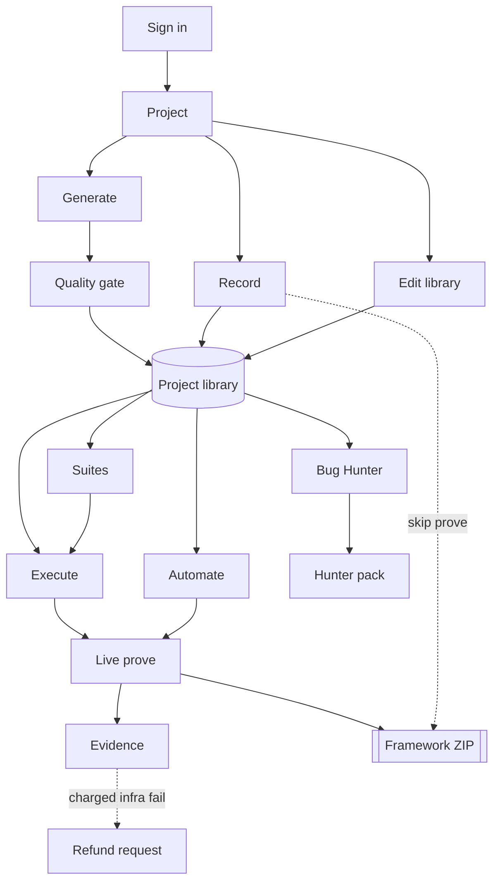
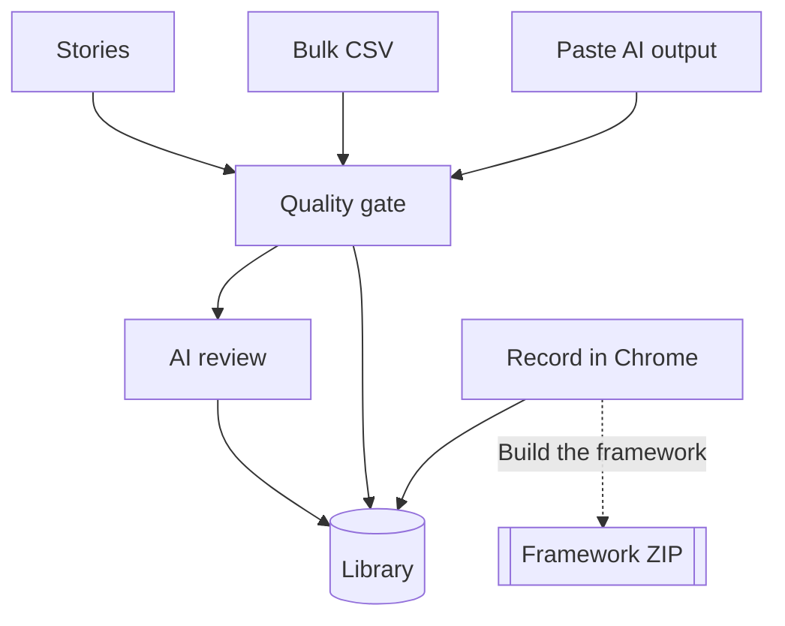
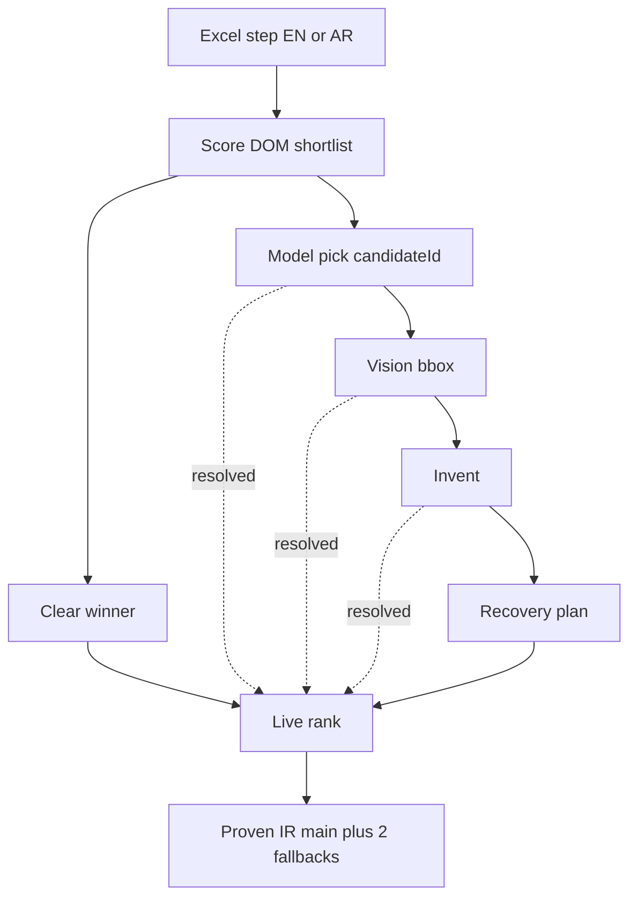
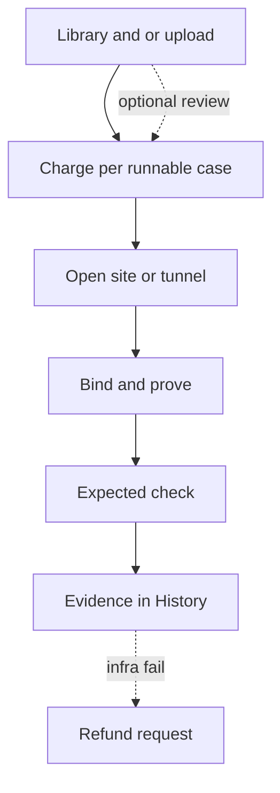
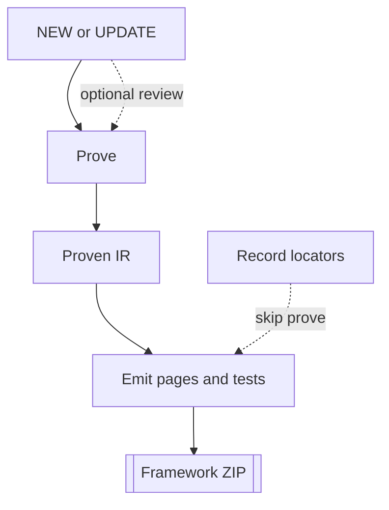
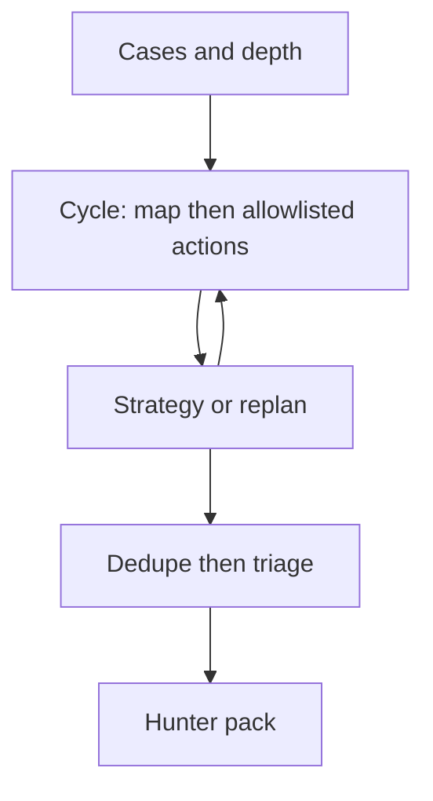
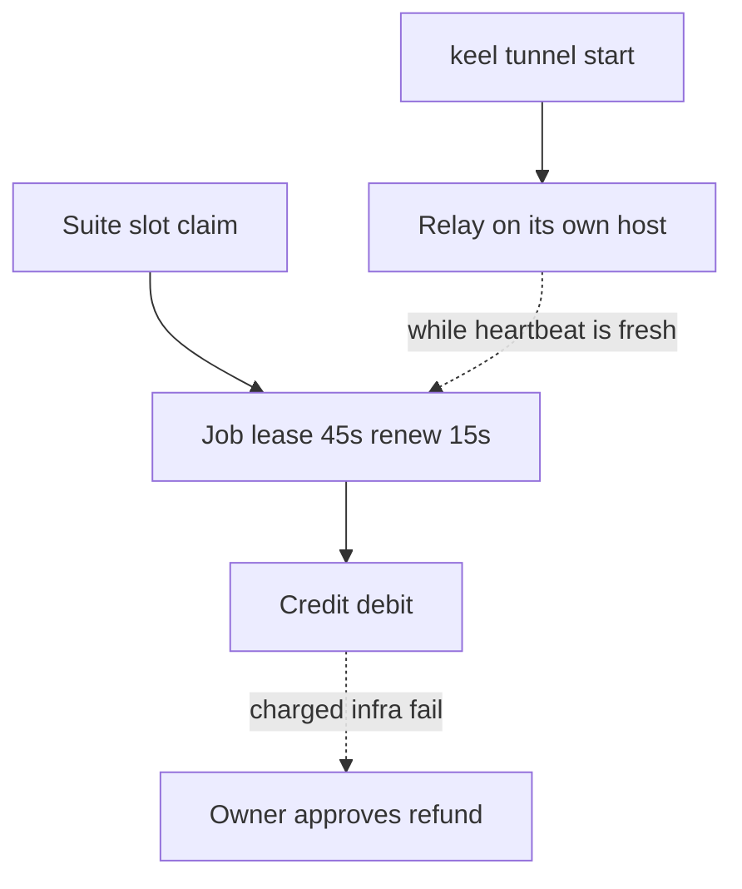

# Keel flows

What is true now, drawn as one map. Behavior detail stays in [`CURRENT.md`](../../../knowledge/CURRENT.md) and [`PRODUCT.md`](../../../PRODUCT.md). This page is the picture of how those flows connect.

Read the product map first. The later sections are the same paths, opened up.

Shared facts:

- Execute and Automate use the same runnable set. `MANUAL` is the only KeelPath both skip. Blank, `AUTOMATE`, `EXECUTE`, and `VISION_ONLY` run on both.
- Execute and Automate share live prove: bind, heal, rank.
- Bug Hunter reads the library and writes a pack. It does not write the library.
- Suites only start an Execute job.
- Record can save a case, or emit a ZIP from captured locators without a second browser visit.

## Into the library

- Generate writer is a live Ollama chat model. Vision names are omitted from that list.
- Test data stays blank or `<PLACEHOLDER>` unless the stories allow inventing. Logins use `${TARGET_USERNAME}` / `${TARGET_PASSWORD}`.
- The quality gate always requires `TC_ID`, `Title`, `Steps`, `ExpectedResult`. It also rejects a vague assert with no quoted UI message, a leave-empty step with test data, and an angle-bracket placeholder typed as text.
- AI review is optional. Accept writes the workbook. Discard leaves it.
- Record is web only, one session per person, 20 minutes. Passwords are not stored. Save adds the next `TC_` with a blank KeelPath.

## Bind, heal, rank

Used by Execute and by Automate prove. One policy (`LocatorStabilityPolicy`) ranks locators for bind, prove, codegen, and vision.

Stable-first order: preferred hook, test id, human id, name, role + accessible name, label, visible text, other CSS, position. Generated ids and absolute `/html` paths are brittle. `user-facing-first` puts role and label ahead of test id.

Heal is only the tie or miss path: shortlist pick, then vision, then invent under a loop budget, then recovery. A clear winner never calls a model. Precision projects replace the Keel pick with one Cursor `groundRank`, then one `solve`, then Keel if the cap or an error hits.

## Execute

Same `TC_ID` in an upload replaces the library row for that run. Pre-run review is not charged. A failed expected check fails the case and does not spend heal. If every case stays TODO, the job is `FAILED` / `ALL_CASES_TODO`.

## Automate

`UPDATE` needs a prior `NEW`. Several cases on one screen merge into one test class. Page names come from the screen under test (`Login_Page`, `Login_Test`). Client-delivery revise runs only when `delivery.final-revise.enabled=true` and AgentRouter is configured.

## Bug Hunter

The planner receives credential tokens, never the password. Invented locators are rejected. Standard depth is about 80 steps (2 rounds × 8 ideas × 5 steps). Max new scenarios is a separate cap. The pack is review-only.

## Suites, jobs, credits, tunnel

- A scheduled suite starts only by claiming the slot. Overlap is `SKIPPED_OVERLAP`. Downtime is `MISSED`.
- Expired `RUNNING` jobs requeue, or fail as `INTERRUPTED_UNCERTAIN` if they were in a browser stage.
- Generate charges one writing job. Execute and Automate charge per runnable case. Hunt charges per step.
- The tunnel public host must be dedicated. The same host as the portal disables the relay. Stale after 60 seconds without a heartbeat, then jobs use the project base URL again.

## Not on this map

| Item | Why it is off the picture |
|------|---------------------------|
| Android | `delivery.mobile.enabled=false`. Not device-accepted. Record refuses Android projects. |
| Agent harness | Defaults off. Not a user-facing Automate change until the flags are on. |
| File upload in the app under test, live Figma, captcha | Not product flows today. |
| Bug Hunter auto-merge | Confirmed findings stay in the pack until a person imports them. |
