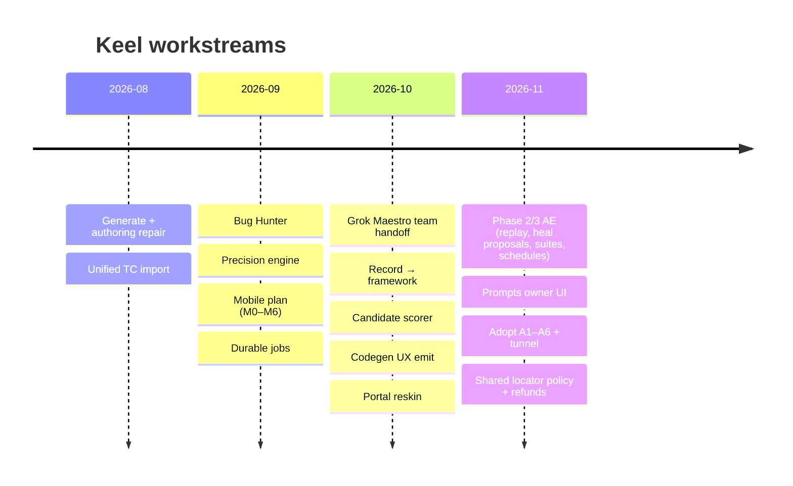

# Keel history

Everything that happened, newest first. **Do not edit old entries** — they record what was true on that day.
For what is true *now*, read [`../knowledge/CURRENT.md`](../knowledge/CURRENT.md). For dated release notes, read [`/CHANGELOG.md`](/CHANGELOG.md).

## How this folder works

- `handoffs/YYYY-MM/` — one file per session or kickoff, named `YYYY-MM-DD-topic.md`. New sessions add a file here.
- `legacy-grok/` — the October 2026 Grok Maestro team notes (per-bot status, early decisions, locator roadmap).
- Contracts that are still in force live in [`../knowledge/contracts/`](../knowledge/contracts/), not here.

## 2026-11

| Date | Session | File |
|------|---------|------|
| 2026-11-08 | Scheduled suites audit (12 defects fixed) | [2026-11-08-scheduled-suites-audit.md](handoffs/2026-11/2026-11-08-scheduled-suites-audit.md) |
| 2026-11-07 | Mobile end to end, generation traceability, Arabic UI, page scripts | [2026-11-07-mobile-generate-ui-i18n.md](handoffs/2026-11/2026-11-07-mobile-generate-ui-i18n.md) |
| 2026-11-07 | Shared locator policy, Arabic steps, refunds, tunnel isolation, durable leases | [2026-11-07-claude-locator-policy-refunds.md](handoffs/2026-11/2026-11-07-claude-locator-policy-refunds.md) |
| 2026-11-07 | Slice F — portal schedule dispatch (Cursor) | [2026-11-07-slice-f-cursor.md](handoffs/2026-11/2026-11-07-slice-f-cursor.md) |
| 2026-11-07 | Slice E — Suites TC picker (Cursor) | [2026-11-07-slice-e-cursor.md](handoffs/2026-11/2026-11-07-slice-e-cursor.md) |
| 2026-11-07 | Audit — defects, business gaps, locator + codegen enhancements (2026-11-07) | [2026-11-07-audit-locators-codegen.md](handoffs/2026-11/2026-11-07-audit-locators-codegen.md) |
| 2026-11-07 | Adopt slices A1–A6 — repo inventory | [2026-11-07-adopt-slices-inventory.md](handoffs/2026-11/2026-11-07-adopt-slices-inventory.md) |
| 2026-11-07 | Adopt A1–A6 + Suites E/F — session handoff (2026-11-07) | [2026-11-07-adopt-cursor-session.md](handoffs/2026-11/2026-11-07-adopt-cursor-session.md) |
| 2026-11-07 | Adopt A5 — cloud tunnel broker | [2026-11-07-adopt-a5-tunnel-broker.md](handoffs/2026-11/2026-11-07-adopt-a5-tunnel-broker.md) |
| 2026-11-03 | Kickoff — Slice D: Wire prompt leftovers (2026-11-03) | [2026-11-03-wire-prompt-leftovers-kickoff.md](handoffs/2026-11/2026-11-03-wire-prompt-leftovers-kickoff.md) |
| 2026-11-03 | Handoff - Slice D AE: wire prompt leftovers (2026-11-03) | [2026-11-03-wire-prompt-leftovers-ae.md](handoffs/2026-11/2026-11-03-wire-prompt-leftovers-ae.md) |
| 2026-11-03 | expect: b1f07bf3f1443703a223adc5afaea81d67686454 | [2026-11-03-push-slice-c-d.md](handoffs/2026-11/2026-11-03-push-slice-c-d.md) |
| 2026-11-03 | Handoff: Push Slice A + Slice B (2026-11-03) | [2026-11-03-push-slice-a-b.md](handoffs/2026-11/2026-11-03-push-slice-a-b.md) |
| 2026-11-03 | 2026-11-03-portal-refresh-wire-prompt-leftovers.md | [2026-11-03-portal-refresh-wire-prompt-leftovers.md](handoffs/2026-11/2026-11-03-portal-refresh-wire-prompt-leftovers.md) |
| 2026-11-03 | 2026-11-03-portal-refresh-boot-prompt-inventory.md | [2026-11-03-portal-refresh-boot-prompt-inventory.md](handoffs/2026-11/2026-11-03-portal-refresh-boot-prompt-inventory.md) |
| 2026-11-03 | Kickoff — Slice C: Boot prompt inventory + fail-fast (2026-11-03) | [2026-11-03-boot-prompt-inventory-kickoff.md](handoffs/2026-11/2026-11-03-boot-prompt-inventory-kickoff.md) |
| 2026-11-03 | Handoff — Slice C: Boot prompt inventory + fail-fast (Backend) | [2026-11-03-boot-prompt-inventory-backend.md](handoffs/2026-11/2026-11-03-boot-prompt-inventory-backend.md) |
| 2026-11-02 | 2026-11-02-qa-testcompile-jobkind.md | [2026-11-02-qa-testcompile-jobkind.md](handoffs/2026-11/2026-11-02-qa-testcompile-jobkind.md) |
| 2026-11-02 | 2026-11-02-qa-gates-visual-diff.md | [2026-11-02-qa-gates-visual-diff.md](handoffs/2026-11/2026-11-02-qa-gates-visual-diff.md) |
| 2026-11-02 | 2026-11-02-qa-gates-visual-diff-r2.md | [2026-11-02-qa-gates-visual-diff-r2.md](handoffs/2026-11/2026-11-02-qa-gates-visual-diff-r2.md) |
| 2026-11-02 | 2026-11-02-qa-gates-plain-cases.md | [2026-11-02-qa-gates-plain-cases.md](handoffs/2026-11/2026-11-02-qa-gates-plain-cases.md) |
| 2026-11-02 | 2026-11-02-qa-gates-phase3-backend.md | [2026-11-02-qa-gates-phase3-backend.md](handoffs/2026-11/2026-11-02-qa-gates-phase3-backend.md) |
| 2026-11-02 | 2026-11-02-qa-gates-phase3-ae.md | [2026-11-02-qa-gates-phase3-ae.md](handoffs/2026-11/2026-11-02-qa-gates-phase3-ae.md) |
| 2026-11-02 | QA gates — Phase 2 Backend (2026-11-02) | [2026-11-02-qa-gates-phase2-backend.md](handoffs/2026-11/2026-11-02-qa-gates-phase2-backend.md) |
| 2026-11-02 | QA gates — Phase 2 AE writers (2026-11-02) | [2026-11-02-qa-gates-phase2-ae.md](handoffs/2026-11/2026-11-02-qa-gates-phase2-ae.md) |
| 2026-11-02 | 2026-11-02-qa-gates-knowledge-ingest.md | [2026-11-02-qa-gates-knowledge-ingest.md](handoffs/2026-11/2026-11-02-qa-gates-knowledge-ingest.md) |
| 2026-11-02 | 2026-11-02-qa-gates-hunt-knowledge.md | [2026-11-02-qa-gates-hunt-knowledge.md](handoffs/2026-11/2026-11-02-qa-gates-hunt-knowledge.md) |
| 2026-11-02 | 2026-11-02-qa-gates-hunt-http-reader.md | [2026-11-02-qa-gates-hunt-http-reader.md](handoffs/2026-11/2026-11-02-qa-gates-hunt-http-reader.md) |
| 2026-11-02 | 2026-11-02-qa-gates-generate-from-knowledge-fe.md | [2026-11-02-qa-gates-generate-from-knowledge-fe.md](handoffs/2026-11/2026-11-02-qa-gates-generate-from-knowledge-fe.md) |
| 2026-11-02 | 2026-11-02-qa-gates-codegen-w3.md | [2026-11-02-qa-gates-codegen-w3.md](handoffs/2026-11/2026-11-02-qa-gates-codegen-w3.md) |
| 2026-11-02 | 2026-11-02-qa-gates-codegen-w2.md | [2026-11-02-qa-gates-codegen-w2.md](handoffs/2026-11/2026-11-02-qa-gates-codegen-w2.md) |
| 2026-11-02 | 2026-11-02-qa-gates-codegen-w1.md | [2026-11-02-qa-gates-codegen-w1.md](handoffs/2026-11/2026-11-02-qa-gates-codegen-w1.md) |
| 2026-11-02 | Handoff — push CLOSED GREEN (2026-11-02) | [2026-11-02-push-closed-green.md](handoffs/2026-11/2026-11-02-push-closed-green.md) |
| 2026-11-02 | Kickoff — Slice B: prompts Owner UI + VERSION (2026-11-02) | [2026-11-02-prompts-owner-ui-kickoff.md](handoffs/2026-11/2026-11-02-prompts-owner-ui-kickoff.md) |
| 2026-11-02 | FE handoff — prompts Owner UI (2026-11-02) | [2026-11-02-prompts-owner-ui-fe.md](handoffs/2026-11/2026-11-02-prompts-owner-ui-fe.md) |
| 2026-11-02 | Handoff — prompts Owner UI Backend (Slice B) (2026-11-02) | [2026-11-02-prompts-owner-ui-backend.md](handoffs/2026-11/2026-11-02-prompts-owner-ui-backend.md) |
| 2026-11-02 | Handoff — prompts Owner UI AE (Slice B Heal stamp) (2026-11-02) | [2026-11-02-prompts-owner-ui-ae.md](handoffs/2026-11/2026-11-02-prompts-owner-ui-ae.md) |
| 2026-11-02 | 2026-11-02-prompts-extract-kickoff.md | [2026-11-02-prompts-extract-kickoff.md](handoffs/2026-11/2026-11-02-prompts-extract-kickoff.md) |
| 2026-11-02 | Handoff - prompts-extract Codegen slice (2026-11-02) | [2026-11-02-prompts-extract-codegen.md](handoffs/2026-11/2026-11-02-prompts-extract-codegen.md) |
| 2026-11-02 | Handoff — prompts-extract Backend slice (2026-11-02) | [2026-11-02-prompts-extract-backend.md](handoffs/2026-11/2026-11-02-prompts-extract-backend.md) |
| 2026-11-02 | 2026-11-02-prompts-extract-ae.md | [2026-11-02-prompts-extract-ae.md](handoffs/2026-11/2026-11-02-prompts-extract-ae.md) |
| 2026-11-02 | 2026-11-02-portal-restart-gfk.md | [2026-11-02-portal-restart-gfk.md](handoffs/2026-11/2026-11-02-portal-restart-gfk.md) |
| 2026-11-02 | 2026-11-02-portal-refresh-prompts-owner-ui.md | [2026-11-02-portal-refresh-prompts-owner-ui.md](handoffs/2026-11/2026-11-02-portal-refresh-prompts-owner-ui.md) |
| 2026-11-02 | 2026-11-02-portal-refresh-prompts-extract.md | [2026-11-02-portal-refresh-prompts-extract.md](handoffs/2026-11/2026-11-02-portal-refresh-prompts-extract.md) |
| 2026-11-02 | 2026-11-02-portal-refresh-plain-english-ui.md | [2026-11-02-portal-refresh-plain-english-ui.md](handoffs/2026-11/2026-11-02-portal-refresh-plain-english-ui.md) |
| 2026-11-02 | 2026-11-02-portal-refresh-phase3-fe.md | [2026-11-02-portal-refresh-phase3-fe.md](handoffs/2026-11/2026-11-02-portal-refresh-phase3-fe.md) |
| 2026-11-02 | 2026-11-02-portal-refresh-phase3-backend.md | [2026-11-02-portal-refresh-phase3-backend.md](handoffs/2026-11/2026-11-02-portal-refresh-phase3-backend.md) |
| 2026-11-02 | 2026-11-02-portal-refresh-phase2-fe.md | [2026-11-02-portal-refresh-phase2-fe.md](handoffs/2026-11/2026-11-02-portal-refresh-phase2-fe.md) |
| 2026-11-02 | 2026-11-02-portal-refresh-phase2-backend.md | [2026-11-02-portal-refresh-phase2-backend.md](handoffs/2026-11/2026-11-02-portal-refresh-phase2-backend.md) |
| 2026-11-02 | 2026-11-02-portal-refresh-guide-pricing.md | [2026-11-02-portal-refresh-guide-pricing.md](handoffs/2026-11/2026-11-02-portal-refresh-guide-pricing.md) |
| 2026-11-02 | 2026-11-02-portal-refresh-gfk-vd.md | [2026-11-02-portal-refresh-gfk-vd.md](handoffs/2026-11/2026-11-02-portal-refresh-gfk-vd.md) |
| 2026-11-02 | 2026-11-02-portal-refresh-credits-addons-confirm.md | [2026-11-02-portal-refresh-credits-addons-confirm.md](handoffs/2026-11/2026-11-02-portal-refresh-credits-addons-confirm.md) |
| 2026-11-02 | 2026-11-02-portal-refresh-codegen-w3.md | [2026-11-02-portal-refresh-codegen-w3.md](handoffs/2026-11/2026-11-02-portal-refresh-codegen-w3.md) |
| 2026-11-02 | 2026-11-02-portal-refresh-codegen-w2.md | [2026-11-02-portal-refresh-codegen-w2.md](handoffs/2026-11/2026-11-02-portal-refresh-codegen-w2.md) |
| 2026-11-02 | 2026-11-02-plain-english-ui.md | [2026-11-02-plain-english-ui.md](handoffs/2026-11/2026-11-02-plain-english-ui.md) |
| 2026-11-02 | 2026-11-02-plain-english-ui-kickoff.md | [2026-11-02-plain-english-ui-kickoff.md](handoffs/2026-11/2026-11-02-plain-english-ui-kickoff.md) |
| 2026-11-02 | Phase 4B — Visual diffs FE (approve baseline UX) — 2026-11-02 | [2026-11-02-phase4-visual-diffs-fe.md](handoffs/2026-11/2026-11-02-phase4-visual-diffs-fe.md) |
| 2026-11-02 | Phase 4 — Visual diffs backend (baselines + compare + approve) — 2026-11-02 | [2026-11-02-phase4-visual-diffs-backend.md](handoffs/2026-11/2026-11-02-phase4-visual-diffs-backend.md) |
| 2026-11-02 | 2026-11-02 — Phase 4 visual diffs (AE) | [2026-11-02-phase4-visual-diffs-ae.md](handoffs/2026-11/2026-11-02-phase4-visual-diffs-ae.md) |
| 2026-11-02 | Phase 4A — Plain-English case author FE shell (2026-11-02) | [2026-11-02-phase4-plain-english-fe.md](handoffs/2026-11/2026-11-02-phase4-plain-english-fe.md) |
| 2026-11-02 | Phase 4A — Plain-English cases backend (2026-11-02) | [2026-11-02-phase4-plain-cases-backend.md](handoffs/2026-11/2026-11-02-phase4-plain-cases-backend.md) |
| 2026-11-02 | 2026-11-02-phase3-spike-kickoff.md | [2026-11-02-phase3-spike-kickoff.md](handoffs/2026-11/2026-11-02-phase3-spike-kickoff.md) |
| 2026-11-02 | 2026-11-02-phase3-kickoff.md | [2026-11-02-phase3-kickoff.md](handoffs/2026-11/2026-11-02-phase3-kickoff.md) |
| 2026-11-02 | Phase 3 — Suites + schedule + alerts / monitor FE shell — 2026-11-02 | [2026-11-02-phase3-fe.md](handoffs/2026-11/2026-11-02-phase3-fe.md) |
| 2026-11-02 | Phase 3 backend — suites + schedules + alerts + monitor (2026-11-02) | [2026-11-02-phase3-backend.md](handoffs/2026-11/2026-11-02-phase3-backend.md) |
| 2026-11-02 | Phase 3 interim API / disk contract — Backend lock for FE/AE (2026-11-02) | [2026-11-02-phase3-api-contract.md](handoffs/2026-11/2026-11-02-phase3-api-contract.md) |
| 2026-11-02 | 2026-11-02-phase3-ae.md | [2026-11-02-phase3-ae.md](handoffs/2026-11/2026-11-02-phase3-ae.md) |
| 2026-11-02 | 2026-11-02-phase2-kickoff.md | [2026-11-02-phase2-kickoff.md](handoffs/2026-11/2026-11-02-phase2-kickoff.md) |
| 2026-11-02 | Phase 2 — Failure replay + heal Accept/Reject FE shell — 2026-11-02 | [2026-11-02-phase2-fe.md](handoffs/2026-11/2026-11-02-phase2-fe.md) |
| 2026-11-02 | Phase 2 backend — failure replay + heal Accept/Reject + flaky tags (2026-11-02) | [2026-11-02-phase2-backend.md](handoffs/2026-11/2026-11-02-phase2-backend.md) |
| 2026-11-02 | Phase 2 interim API / disk contract — Backend lock for AE/FE (2026-11-02) | [2026-11-02-phase2-api-contract.md](handoffs/2026-11/2026-11-02-phase2-api-contract.md) |
| 2026-11-02 | 2026-11-02 — Phase 2 AE (failure replay + heal proposals + flaky tags) | [2026-11-02-phase2-ae.md](handoffs/2026-11/2026-11-02-phase2-ae.md) |
| 2026-11-02 | 2026-11-02-knowledge-pack-contract.md | [2026-11-02-knowledge-pack-contract.md](handoffs/2026-11/2026-11-02-knowledge-pack-contract.md) |
| 2026-11-02 | Knowledge ingest + GFK create-run (Backend Phase 1) — 2026-11-02 | [2026-11-02-knowledge-ingest-backend.md](handoffs/2026-11/2026-11-02-knowledge-ingest-backend.md) |
| 2026-11-02 | 2026-11-02-improvement-plan-kickoff.md | [2026-11-02-improvement-plan-kickoff.md](handoffs/2026-11/2026-11-02-improvement-plan-kickoff.md) |
| 2026-11-02 | Hunt Knowledge Pack guidance (AE) — 2026-11-02 | [2026-11-02-hunt-knowledge-ae.md](handoffs/2026-11/2026-11-02-hunt-knowledge-ae.md) |
| 2026-11-02 | 2026-11-02-guide-pricing-kickoff.md | [2026-11-02-guide-pricing-kickoff.md](handoffs/2026-11/2026-11-02-guide-pricing-kickoff.md) |
| 2026-11-02 | 2026-11-02-guide-pricing-fe.md | [2026-11-02-guide-pricing-fe.md](handoffs/2026-11/2026-11-02-guide-pricing-fe.md) |
| 2026-11-02 | Handoff — Guide + Pricing backend (covers + draft add-on seeds) | [2026-11-02-guide-pricing-backend.md](handoffs/2026-11/2026-11-02-guide-pricing-backend.md) |
| 2026-11-02 | Generate from knowledge — FE Phase 1 shell (2026-11-02) | [2026-11-02-generate-from-knowledge-fe.md](handoffs/2026-11/2026-11-02-generate-from-knowledge-fe.md) |
| 2026-11-02 | 2026-11-02-credits-model-inventory.md | [2026-11-02-credits-model-inventory.md](handoffs/2026-11/2026-11-02-credits-model-inventory.md) |
| 2026-11-02 | 2026-11-02-credits-addons-confirm-kickoff.md | [2026-11-02-credits-addons-confirm-kickoff.md](handoffs/2026-11/2026-11-02-credits-addons-confirm-kickoff.md) |
| 2026-11-02 | FE — Confirm credit add-ons (no Draft UI) — 2026-11-02 | [2026-11-02-credits-addons-confirm-fe.md](handoffs/2026-11/2026-11-02-credits-addons-confirm-fe.md) |
| 2026-11-02 | Handoff — Confirm credit add-ons backend (2026-11-02) | [2026-11-02-credits-addons-confirm-backend.md](handoffs/2026-11/2026-11-02-credits-addons-confirm-backend.md) |
| 2026-11-02 | Codegen W3 — Automate emit (multi-locator bag + DOM-diff asserts + heal Accept + NL→By cache) | [2026-11-02-codegen-w3.md](handoffs/2026-11/2026-11-02-codegen-w3.md) |
| 2026-11-02 | 2026-11-02-codegen-w3-kickoff.md | [2026-11-02-codegen-w3-kickoff.md](handoffs/2026-11/2026-11-02-codegen-w3-kickoff.md) |
| 2026-11-02 | 2026-11-02-codegen-w2.md | [2026-11-02-codegen-w2.md](handoffs/2026-11/2026-11-02-codegen-w2.md) |
| 2026-11-02 | 2026-11-02-codegen-w2-kickoff.md | [2026-11-02-codegen-w2-kickoff.md](handoffs/2026-11/2026-11-02-codegen-w2-kickoff.md) |
| 2026-11-02 | Codegen W1 — Automate emit (preferred-hook-first + assert-from-element + isLoaded + parameterized rows) | [2026-11-02-codegen-w1.md](handoffs/2026-11/2026-11-02-codegen-w1.md) |
| 2026-11-02 | Kickoff — Slice A: wire add-on job debit (2026-11-02) | [2026-11-02-addon-job-debit-kickoff.md](handoffs/2026-11/2026-11-02-addon-job-debit-kickoff.md) |
| 2026-11-02 | Handoff — Slice A: add-on job debit (Backend) — 2026-11-02 | [2026-11-02-addon-job-debit-backend.md](handoffs/2026-11/2026-11-02-addon-job-debit-backend.md) |

## 2026-10

| Date | Session | File |
|------|---------|------|
| 2026-10-21 | Portal artifact delete (2026-10-21) | [2026-10-21-portal-artifact-delete.md](handoffs/2026-10/2026-10-21-portal-artifact-delete.md) |
| 2026-10-20 | 2026-10-20 — List-row-first click + extra Treat as kinds | [2026-10-20-list-row-first-and-treat-as.md](handoffs/2026-10/2026-10-20-list-row-first-and-treat-as.md) |
| 2026-10-20 | 2026-10-20 — Codegen UX emit | [2026-10-20-codegen-ux-emit.md](handoffs/2026-10/2026-10-20-codegen-ux-emit.md) |
| 2026-10-19 | 2026-10-19 — Scoped nested preferred hook | [2026-10-19-scoped-nested-hook.md](handoffs/2026-10/2026-10-19-scoped-nested-hook.md) |
| 2026-10-19 | 2026-10-19 — Nested preferred hook + leftover Expected quoting | [2026-10-19-nested-hook-and-quote-heading.md](handoffs/2026-10/2026-10-19-nested-hook-and-quote-heading.md) |
| 2026-10-19 | 2026-10-19 — Authoring verb aliases | [2026-10-19-authoring-verb-aliases.md](handoffs/2026-10/2026-10-19-authoring-verb-aliases.md) |
| 2026-10-19 | 2026-10-19 — Admin review batch size + browser type | [2026-10-19-admin-review-batch-and-browser.md](handoffs/2026-10/2026-10-19-admin-review-batch-and-browser.md) |
| 2026-10-18 | 2026-10-18 — Live Ollama models on Generate | [2026-10-18-live-ollama-generate-models.md](handoffs/2026-10/2026-10-18-live-ollama-generate-models.md) |
| 2026-10-18 | 2026-10-18 — Add test case + review cases before run | [2026-10-18-library-add-and-prerun-review.md](handoffs/2026-10/2026-10-18-library-add-and-prerun-review.md) |
| 2026-10-15 | Portal session — 2026-10-15 | [2026-10-15-portal-session.md](handoffs/2026-10/2026-10-15-portal-session.md) |

## Legacy (Grok Maestro, Oct 2026)

| File | Content |
|------|---------|
| [grok-maestro-handoff-2026-10-14.md](legacy-grok/grok-maestro-handoff-2026-10-14.md) | Earlier timeline — what landed locally, priorities |
| [per-bot-status.md](legacy-grok/per-bot-status.md) | Who (Codegen, Frontend, Backend, Automation, QA) did what |
| [locator-and-split-roadmap.md](legacy-grok/locator-and-split-roadmap.md) | Locator bottlenecks, borrowed ideas, portal/engine split |
| [decisions-and-open-questions.md](legacy-grok/decisions-and-open-questions.md) | Owner answers + open items at that time |
