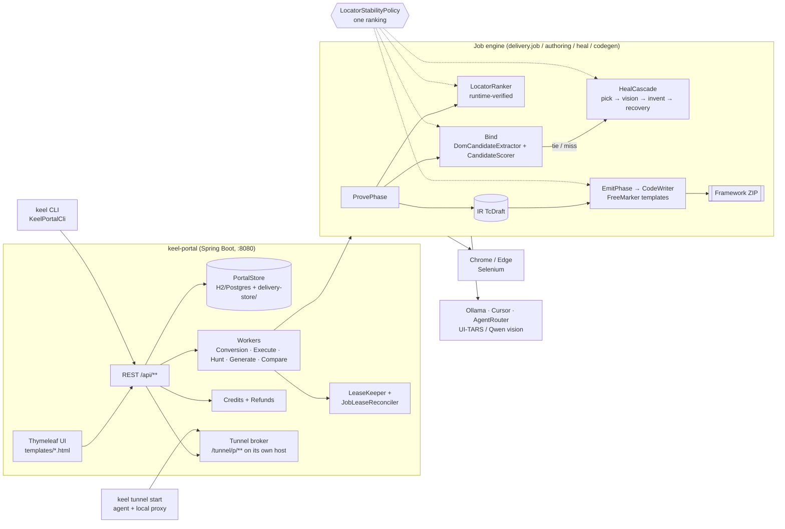
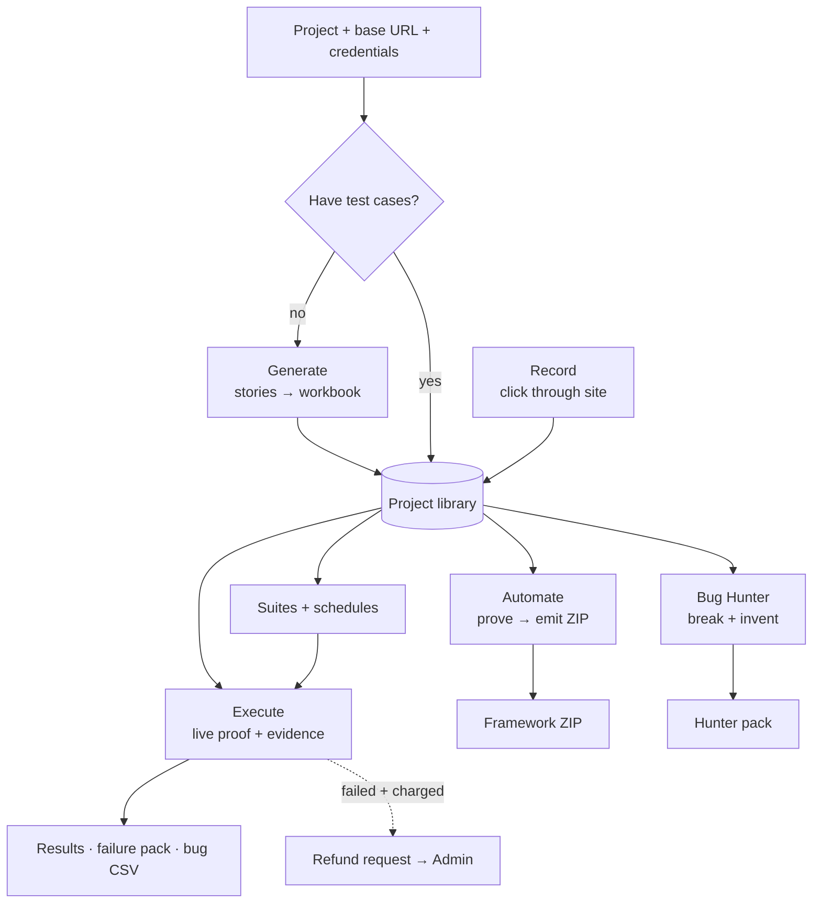

# Keel — current project knowledge

> **What is true now.** Updated 2026-11-08. When something changes, edit this page in the same commit.
> History (what was true on a given day) is in [`../history/HISTORY.md`](../history/HISTORY.md).
> Engineer entry point: [`../ENGINEERING_HANDOFF.md`](../ENGINEERING_HANDOFF.md). User-facing features: [`../PRODUCT.md`](../PRODUCT.md).

## 1. What Keel is

Keel (repo `TestPilot`) turns manual test intent into **live browser evidence** and **customer-ready Selenium/TestNG
frameworks**. Users generate or import test cases, Keel binds every step to the live DOM (bind → heal → recovery), proves
it in a real browser, then either reports results (**Execute**) or emits a framework ZIP (**Automate**).

## 2. Architecture



### Modules

| Module / folder | Role |
|-----------------|------|
| `src/main/java/delivery/` | All portal + engine sources (built by `keel-portal`) |
| `keel-portal/` | Maven module that packages the portal fat jar; `-Pkeel-cli` → `keel-cli.jar` |
| `keel-contract/`, `keel-common/`, `keel-engine/` | Runner wire contract and shared code for the remote engine |
| `customer-framework-template/` | Web Selenium/TestNG core copied into every ZIP (`KeelBy`, `FirstOf`, `KeelLocate`, `SettledActions`) |
| `mobile-contracts/`, `mobile-runner/`, `mobile-codegen/`, `customer-mobile-framework-template/` | Android (behind `delivery.mobile.enabled=false`; not device-accepted) |
| `src/main/resources/prompts/` | Runtime prompt catalog (`PromptCatalog`, Admin → Prompts, `VERSION`) |
| `src/main/resources/static/js/pages/` | Page scripts extracted from templates (server values via `window.KEEL_PAGE`) |
| `tools/cursor-heal/` | Cursor sidecar for heal/hunt |

### Key packages

| Package | What lives there |
|---------|------------------|
| `delivery.locator` | **`LocatorStabilityPolicy`, `LocatorTier`, `LocatorMode`** — the one locator ranking |
| `delivery.authoring` | DOM candidate extraction, `CandidateScorer`, `StepIntentBinder`, `IntentText` (Unicode/Arabic), `GeneratedIdDetector`, `LocatorValidator` |
| `delivery.snapshot` | `LocatorRanker` (runtime uniqueness), `KeelTarget` (frame/shadow hops) |
| `delivery.heal` | `HealCascade`, Cursor/Ollama clients, invent, recovery, heal proposals |
| `delivery.vision` | UI-TARS/Qwen providers, `ElementGrounder` (bbox → element → locator), vision asserts |
| `delivery.codegen` | `PageAccumulator`, `SemanticLocatorLadder`, `MultiLocatorBag`, `CodeWriter`, naming |
| `delivery.job` | Prove/Emit/Revise phases, runners, retry/failure classification |
| `delivery.portal.*` | API controllers, services, workers, security, credits, tunnel, jobs (leases) |
| `delivery.mobile` | Mobile store, APK upload/inspection, device leases, Appium lifecycle |

## 3. Core flows



### Step → locator (bind, prove, emit)

```mermaid
sequenceDiagram
    participant TC as Excel step
    participant B as Bind (CandidateScorer)
    participant H as HealCascade
    participant R as LocatorRanker (live)
    participant C as Codegen (Ladder + Bag)
    TC->>B: intent text (EN/AR) → IntentText tokens + verb
    B->>B: score = stability(tier) + uniqueness + intent + role + label
    alt clear winner
        B-->>R: chosen candidate
    else tie / miss
        B->>H: shortlist → model pick → vision → invent
        H-->>R: candidate
    end
    R->>R: generate tiers, verify unique & same element, sort by policy
    R-->>C: main + 2 fallbacks (IR)
    C->>C: promote test id / hook; drop brittle; FirstOf or KeelBy field
```

### Heal cascade

DOM shortlist pick (Ollama or Cursor; returns `candidateId` only) → optional vision widen (bbox → `elementFromPoint` →
interactive ancestor → existing candidate or new validated locator) → last-hope invent (Cursor/AgentRouter, intent-token
check, LoopGuard budget) → recovery plan (`mode: recovery`). Heal proposals are propose-only (`heal-proposals/`).

## 4. Locator policy (one ranking for everything)

`delivery.locator.LocatorStabilityPolicy` classifies every locator into a `LocatorTier` and ranks it under the project's
`LocatorMode`. Used by `CandidateScorer` (bind), `LocatorRanker` + `ProveWiring` (prove), `SemanticLocatorLadder` /
`MultiLocatorBag` / `EmitStepNormalizer` (codegen) and `ElementGrounder` (vision).

| Order (stable-first, default) | Examples |
|-------------------------------|----------|
| 1 Preferred hook | `button[data-axis-test-id='save']` |
| 2 Test id | `[data-testid]`, `[data-test]`, `[data-qa]`, `[data-cy]` |
| 3 Unique human id | `#email` (not `ember123`, `:r0:`, `ctl00_…`) |
| 4 Unique name | `[name='email']` (not ASP.NET `ctl00$…` / JSF `j_idt12:…`) |
| 5 Role + accessible name | `button[aria-label='Save']`, `[role='button'][aria-label=…]` |
| 6 Label | placeholder, title, alt, `//label[…]//input` |
| 7 Visible text | `//button[contains(normalize-space(.),'Save')]`, `text=` |
| 8 Other attribute CSS/XPath | `input[type='email']` |
| 9 Positional | `(//input)[3]`, `:nth-child` |
| 0 Brittle | generated ids/classes (`css-1x2y3z`, `Button_root__a8f3k`), `/html/...` |

- A verified test id/hook is **always** promoted to primary, even without preferred hooks.
- `user-facing-first` (Projects → Settings → Locator ranking) puts role/label before test id (Playwright style).
- Stored in the site's `preferred-hooks.json` as `locatorMode`.

## 4b. Scheduled suites

- Slot claim is the only way a scheduled run starts: portal worker (`SuiteScheduleDispatchService`, claims first) or
  `POST …/suites/{id}/runs` with trigger `schedule`/`monitor` (claims inside `SuiteRunService`). `suites.json` is locked
  per project and written atomically.
- Overlap → `SKIPPED_OVERLAP`; downtime → `MISSED`; refused start → `lastFailure` + `SUITE_SCHEDULE_FAILED` alert.
- Suite context is persisted per job (`suite-context.json`, with `alertMinSeverity`) and restored by `ExecuteWorker`;
  outcome written back (`lastJobStatus`, `lastResult`, monitor `lastStatus`).
- Alert channels: `EmailAlertChannel` uses `JavaMailSender` (Gmail works via `spring.mail.*` env),
  `TelegramAlertChannel` calls `api.telegram.org` (off by default). Slack was dropped. Admin:
  `GET/POST /api/admin/alerts/channels[/{id}/test]`. Per-suite `alertMinSeverity` can raise the
  floor above the channel default.
- Suite alerts also go to every project member's own account alert settings (Settings → alerts:
  email / Telegram chat id / Slack webhook), bound channel or not. `SuiteScheduleWiring` registers
  `SuiteAlertNotifier.registerMemberAlerts` → `AccountAlertService.notifySuiteAlert` (async) with
  `PortalStore.projectMemberIds`. Per-suite `alertMinSeverity` applies to members too.
- No early starts: the portal worker and API claim window are both `0`; a slot is due only once
  `nextRunAt <= now`.

## 5. Durable jobs

- `PortalStore.beginWork` claims a job (lease 45 s) and hands it to `LeaseKeeper`, which renews every 15 s for **every**
  worker kind until the job ends, is cancelled/fenced, or exceeds `-Ddelivery.jobs.max-runtime-minutes` (180).
- `JobLeaseReconciler` runs at startup and every `delivery.jobs.lease-reconcile-ms` (60 s): expired RUNNING jobs requeue,
  or fail as `INTERRUPTED_UNCERTAIN` if they were in a browser stage.
- `JobEntity.error_code` persists the machine error (previously lost on restart).

## 6. Credits and refunds

- Debit: `CreditService.tryDebitForJob` (idempotent `debit:job:{id}`); add-ons via `tryDebitForAddon`.
- Refund requests (`refund_requests`): **auto** for charged FAILED jobs whose error/message classifies as
  `RetryCategory.INFRA` (sweep every 2 min, 72 h lookback); **user** from the run page.
- **Admin → Refunds** (account owner): list by status, detail with user, project, run, charge, failure category/code/
  message, diagnostics (stage, attempt, providers, fallback), timeline, ledger, links (run, evidence, failure pack),
  recommendation; approve full/partial or reject with a reason. Approval writes idempotent `JOB_REFUND` (`refund:job:{id}`).

## 7. Cloud tunnel (A5)

- `delivery.tunnel.public-base-url` **must be a dedicated host** (e.g. `https://tunnel.keel.example`). Same host as
  `delivery.public-base-url` ⇒ relay disabled (badge says why). Loopback hosts = dev mode.
- `keel tunnel start --project <id> --target http://localhost:<port>` caches credentials in `KEEL_HOME/tunnel/` and reuses
  the token; `--re-enroll` rotates it. Heartbeat 15 s; tunnel is `stale` after `delivery.tunnel.heartbeat-ttl-seconds` (60).
- Relay carries multi-value headers (`multiHeaders`); portal cookies never cross the relay.

## 8. Configuration that matters

| Key | Default | Meaning |
|-----|---------|---------|
| `delivery.public-base-url` | `http://localhost:8080` | Portal origin |
| `delivery.tunnel.enabled` / `.public-base-url` / `.heartbeat-ttl-seconds` | false / — / 60 | Tunnel broker |
| `delivery.credits.enabled` | per env | Credits + refunds UI |
| `delivery.credits.refunds.auto-open` / `.sweep-ms` / `.sweep-lookback-hours` | true / 120000 / 72 | Automatic refund requests |
| `delivery.jobs.lease-reconcile-ms` | 60000 | Periodic lease reclaim |
| `delivery.suites.portal-schedule-worker.enabled` | true | Portal-side schedule dispatch (Slice F) |
| `delivery.suites.schedule-zone` / `.misfire-grace-minutes` | Africa/Cairo / 60 | Default cron zone; skip slots missed longer than this |
| `delivery.mobile.enabled` | false | Android features |
| `delivery.authoring.precision.*` | — | Precision engine gate and call cap |

## 9. Status (2026-11-07)

| Area | State |
|------|-------|
| Generate, Record, Automate, Execute, Bug Hunter, Compare | Shipped |
| Suites (picker E, schedule dispatch F) | Shipped (F flagged off) |
| Adopt A1–A6 (failure pack, structured plans, CLI, run memory, tunnel, vision policy) | Shipped |
| Shared locator policy, Arabic steps, refunds, tunnel host isolation, lease renewal | Shipped 2026-11-07, **build/tests pending** |
| Mobile | Run end to end (Project → Mobile → Run on a phone + `scripts\mobile-runner.cmd`), lease renewal and stuck-device recovery; **not yet device-accepted** |
| Generation traceability | `req:` tags, Story coverage panel; prompts in catalog (`prompts/generate/*`) |
| Portal language | English / Arabic (RTL) — menus, top bar, page headings; body copy still English |
| Open review items | [`REVIEW-2026-11-07.md`](REVIEW-2026-11-07.md) |

## 9b. UI conventions

- Language: `?lang=ar|en` (cookie `keel-lang`), strings in `messages.properties` / `messages_ar.properties`, `th:text="#{key}"` with English inline fallback.
- RTL: `keel-rtl.css` is **generated** — run `python scripts/gen-rtl-css.py` after editing portal CSS.
- No `alert/confirm`: use `keelConfirm(...)`, `keelAlert(...)` from `keel-confirm.js`.
- Page JS lives in `static/js/pages/<page>.js`; pass server values with one inline `window.KEEL_PAGE = {...}` line.

## 10. Contracts in force

- Suites Slice E: [`contracts/E-contract-map.md`](contracts/E-contract-map.md)
- Suites Slice F: [`contracts/F-transaction-map.md`](contracts/F-transaction-map.md)
- Keel target grammar (frame/shadow/css/text): `customer-framework-template/.../KeelLocate.java` header

## 11. How to work on this repo

```bat
mvn -pl keel-portal -am -DskipTests package     & rem build
mvn -pl keel-portal test                          & rem all tests
start-portal.cmd                                  & rem http://localhost:8080
scripts\graphify-update.cmd                       & rem refresh code graph (Python 3.12)
```

- Code graph: `graphify-out/GRAPH_REPORT.md` (read first), `graphify-out/graph.html`.
- New session notes go to `docs/history/handoffs/YYYY-MM/YYYY-MM-DD-topic.md` and a line in `CHANGELOG.md`;
  update this page when the *current* truth changes.
